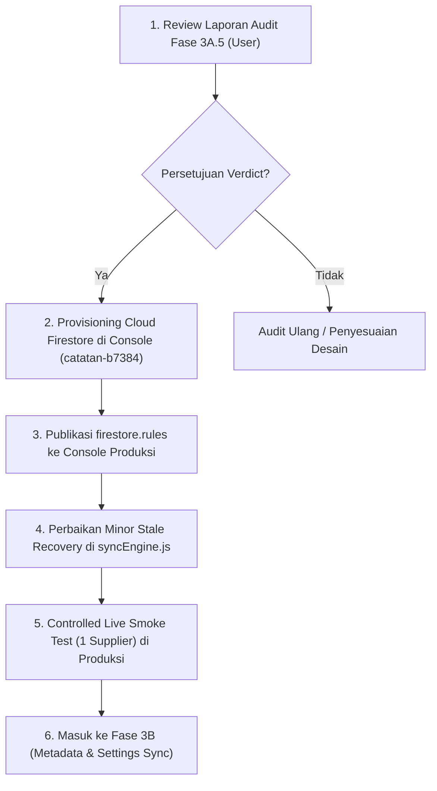

# AUDIT PRODUCTION READINESS: KESIAPAN INTEGRASI FIREBASE CLOUD (FASE 3A.5)

**Proyek:** Catatan Warung Madura  
**Firebase Project ID:** `catatan-b7384`  
**Status Audit:** READ-ONLY COMPREHENSIVE AUDIT  
**Tanggal Audit:** 23 November 2026  
**Auditor:** Antigravity AI (Google DeepMind Team)  

---

## 1. EXECUTIVE SUMMARY

Audit Kesiapan Produksi Fase 3A.5 dilakukan secara menyeluruh terhadap arsitektur teknis, konfigurasi lingkungan, keamanan Firestore Security Rules, alur autentikasi, antrean *offline-first* IndexedDB, mesin sinkronisasi *Sync Engine*, serta mekanisme *initial backfill* pada aplikasi **Catatan Warung Madura**.

Hasil audit mengonfirmasi bahwa fondasi kode lokal, logika idempotensi ganda (*client-side* IndexedDB + *server-side* Firestore ledger), validasi muatan (*payload*), isolasi multi-tenant berbasis `ownerUid`, serta antrean persisten telah terimplementasi dengan standar keamanan yang sangat tinggi, dibuktikan dengan kelulusan **90 / 90 (100%)** pengujian otomatis lokal dan verifikasi antarmuka di peramban aktif.

Namun demikian, dari perspektif kesiapan produksi (*production readiness*), sistem saat ini **BELUM SIAP (NOT READY)** untuk menjalankan sinkronisasi cloud produksi langsung karena adanya **2 (dua) temuan kritis (*Critical Risks*)**:
1. **Basis Data Cloud Firestore Produksi Belum Dibuat (`NOT CREATED`):** Pada Firebase Console project `catatan-b7384`, layanan Cloud Firestore masih berada pada tahap inisialisasi awal (*"Create database"*).
2. **Ketiadaan *Guard* Isolasi Lingkungan pada Runtime Aplikasi (`firebase.js`):** Runtime aplikasi di peramban langsung menggunakan konfigurasi proyek `catatan-b7384` tanpa mekanisme *switch* ke emulator lokal saat dijalankan di `localhost:5173`.

Laporan ini menyajikan analisis mendalam, pemetaan risiko terstruktur, serta panduan prasyarat terkontrol sebelum pengguna mengalokasikan basis data dan memublikasikan aturan keamanan ke Firebase Console.

---

## 2. RUANG LINGKUP AUDIT

Audit ini mencakup evaluasi menyeluruh terhadap:
- **Konfigurasi & Lingkungan Firebase:** Pemisahan antara pengembangan (*development*), emulator lokal, dan produksi (*production*).
- **Firestore Security Rules:** Keabsahan `firestore.rules`, logika otorisasi `isStoreOwner`, integritas mutasi atomik, dan proteksi buku besar (*ledger*) idempotensi abadi.
- **Firebase Authentication:** Konsistensi identitas kriptografis `currentUser.uid`, persistensi sesi, siklus hidup login/logout, dan pengamanan gerbang autentikasi (*AuthGate*).
- **Sync Engine & Initial Backfill:** Kestabilan ID toko pemasok (`st-...`), penanganan konkurensi multi-tab (*Web Locks API*), *lease claim* atomik di IndexedDB, serta pencegahan kegagalan hening (*silent failure*).
- **Kesiapan Database Produksi:** Struktur jalur dokumen tenant, subkoleksi, dan kebutuhan indeks.
- **Keselamatan Data Lokal:** Perlindungan terhadap data operasional warung yang telah ada di `localStorage: wm_v1_stores`.
- **Verifikasi Pengujian:** Pemisahan tegas antara pengujian otomatis emulator dengan verifikasi lingkungan produksi aktual.

---

## 3. DAFTAR FILE YANG DITINJAU

| File / Modul | Peran Utama | Lokasi File |
| :--- | :--- | :--- |
| `src/services/firebase.js` | Inisialisasi Firebase App, Auth, dan Firestore | [src/services/firebase.js](file:///d:/catatan/src/services/firebase.js) |
| `firestore.rules` | Firestore Security Rules (337 baris) | [firestore.rules](file:///d:/catatan/firestore.rules) |
| `src/context/AuthContext.jsx` | Pengelola state autentikasi dan identitas pemilik | [src/context/AuthContext.jsx](file:///d:/catatan/src/context/AuthContext.jsx) |
| `src/context/AppContext.jsx` | Pusat *state* bisnis warung, migrasi, dan mutasi data | [src/context/AppContext.jsx](file:///d:/catatan/src/context/AppContext.jsx) |
| `src/App.jsx` | Routing aplikasi dan gerbang proteksi `AuthGate` | [src/App.jsx](file:///d:/catatan/src/App.jsx) |
| `src/services/offlineQueue.js` | Antrean IndexedDB persisten, klaim atomik, dan recovery | [src/services/offlineQueue.js](file:///d:/catatan/src/services/offlineQueue.js) |
| `src/services/syncEngine.js` | Mesin sinkronisasi, Web Locks, transaksi cloud, dan backfill | [src/services/syncEngine.js](file:///d:/catatan/src/services/syncEngine.js) |
| `src/pages/Pengaturan.jsx` | UI Diagnostik Sync Engine, Pratinjau Backfill, & Umpan Balik | [src/pages/Pengaturan.jsx](file:///d:/catatan/src/pages/Pengaturan.jsx) |
| `scripts/test-firestore-rules.mjs` | Test suite otomatis Security Rules (Fase 0) | [scripts/test-firestore-rules.mjs](file:///d:/catatan/scripts/test-firestore-rules.mjs) |
| `scripts/test-fase1-auth.mjs` | Test suite otomatis Authentication (Fase 1) | [scripts/test-fase1-auth.mjs](file:///d:/catatan/scripts/test-fase1-auth.mjs) |
| `scripts/test-fase2-queue.mjs` | Test suite otomatis Offline Queue (Fase 2) | [scripts/test-fase2-queue.mjs](file:///d:/catatan/scripts/test-fase2-queue.mjs) |
| `scripts/test-fase3a-sync.mjs` | Test suite otomatis Sync Engine & Supplier Pilot (Fase 3A) | [scripts/test-fase3a-sync.mjs](file:///d:/catatan/scripts/test-fase3a-sync.mjs) |
| `scripts/test-fase3a-backfill.mjs` | Test suite otomatis Initial Backfill & Feedback (Fase 3A Fix) | [scripts/test-fase3a-backfill.mjs](file:///d:/catatan/scripts/test-fase3a-backfill.mjs) |

---

## 4. FIREBASE ENVIRONMENT AUDIT

### A. Sumber dan Parameter Konfigurasi
- **Konfigurasi Proyek:** Didefinisikan secara statis pada objek `firebaseConfig` di [src/services/firebase.js:14-21](file:///d:/catatan/src/services/firebase.js#L14-L21).
  - `projectId`: `catatan-b7384`
  - `authDomain`: `catatan-b7384.firebaseapp.com`
  - `storageBucket`: `catatan-b7384.firebasestorage.app`
  - Kredensial API Key: Ditanam langsung (*hardcoded*), tidak menggunakan variabel lingkungan `.env` (`import.meta.env`).
- **Instansiasi Singleton:**
  `app = getApps().find((a) => a.name === '[DEFAULT]') || initializeApp(firebaseConfig);`
  Mencegah *duplicate app initialization* saat modul dimuat ulang (HMR).

### B. Pemisahan Lingkungan (Development vs. Emulator vs. Production)
- **Ketiadaan Emulator Guard di Runtime Aplikasi:**
  Berkas `src/services/firebase.js` **TIDAK MEMILIKI** logika pemanggilan `connectFirestoreEmulator` maupun `connectAuthEmulator`.
- **Dampak Kritis:**
  Ketika aplikasi dijalankan di lingkungan lokal pengembang (`npm run dev` pada `http://localhost:5173`), aplikasi langsung mengarahkan koneksi ke endpoint publik Google Cloud (`catatan-b7384.firebaseapp.com` dan `firestore.googleapis.com`).
  - *Status Emulator:* Emulator Firebase **hanya** digunakan oleh skrip pengujian berbasis Node.js (`scripts/test-*.mjs`) melalui `initializeTestEnvironment` dari `@firebase/rules-unit-testing`.
  - *Risiko Kebocoran/Salah Sasaran:* Pengembang atau kasir yang membuka `localhost:5173` berinteraksi langsung dengan Firebase Authentication produksi. Begitu basis data produksi dibuat, mutasi lokal akan langsung mencoba dikirim ke cloud produksi tanpa sekat staging.

### C. Asumsi Basis Data Target
- Instansiasi `db = getFirestore(app)` mengasumsikan basis data target adalah **`(default)` database**.
- Tidak ada deteksi ketersediaan basis data sebelum pemanggilan transaksi Firestore. Jika basis data belum dialokasikan di Google Cloud, panggilan transaksi SDK melempar pengecualian `FirebaseError: The database (default) does not exist for project catatan-b7384`.

---

## 5. FIRESTORE SECURITY RULES AUDIT

Audit terhadap [firestore.rules](file:///d:/catatan/firestore.rules) (337 baris):

### A. Verifikasi Identitas & Otorisasi Pemilik Toko
- **Fungsi Autentikasi Dasar:**
  ```javascript
  function isAuthenticated() {
    return request.auth != null && request.auth.uid != null;
  }
  ```
- **Fungsi Otorisasi Pemilik (`isStoreOwner`):**
  ```javascript
  function isStoreOwner(storeId) {
    return isAuthenticated() && 
      exists(/databases/$(database)/documents/stores_app/$(storeId)) &&
      request.auth.uid == get(/databases/$(database)/documents/stores_app/$(storeId)).data.ownerUid;
  }
  ```
  *Kekuatan Keamanan:*
  1. Akses hanya diberikan jika dokumen profil warung `/stores_app/{storeId}` benar-benar ada di basis data.
  2. Atribut `ownerUid` pada dokumen tersebut harus sama persis dengan `request.auth.uid` pengguna yang terautentikasi.
  3. Dokumen root `/stores_app/{storeId}` memproteksi atribut `ownerUid` dengan `isImmutableKey('ownerUid')`, sehingga hak kepemilikan tidak dapat dialihkan ke pihak lain secara ilegal.

### B. Isolasi Multi-Tenant
- Penamaan tenant warung bersifat deterministik: `store_{ownerUid}`.
- Pengguna `Bob` yang mencoba membaca atau menulis subkoleksi milik `Alice` (`/stores_app/store_uid_alice/...`) secara mutlak ditolak oleh `isStoreOwner` karena `request.auth.uid == 'uid_bob'` tidak cocok dengan `ownerUid: 'uid_alice'`. Hal ini terverifikasi 100% pada Uji Skenario 3 di `test:rules`.

### C. Proteksi Buku Besar Idempotensi Abadi (`/operations_log/{opId}`)
- Aturan untuk ledger server:
  ```javascript
  match /operations_log/{opId} {
    allow read: if isStoreOwner(storeId);
    allow create: if isStoreOwner(storeId)
      && isNotMaintenanceLocked(storeId)
      && request.resource.data.opId is string && request.resource.data.opId.size() > 0
      && request.resource.data.ownerUid == request.auth.uid
      && isValidTimestamp(request.resource.data.clientTimestamp);
    allow update, delete: if false; // Buku audit ledger transaksi server bersifat abadi
  }
  ```
  *Kekuatan Keamanan:* Klien web tidak memiliki izin untuk mengedit atau menghapus rekaman ledger. Sekali `opId` tercatat di cloud, ledger tersebut terkunci permanen.

### D. Kesiapan Domain Supplier Pilot (`/suppliers/{supplierId}`)
- Create/Update memvalidasi:
  - `name is string && name.size() > 0` (Nama wajib diisi).
  - `isValidTimestamp(updatedAt)` (Wajib berformat ISO 8601 dengan panjang $\ge 19$ karakter).
  - Terkunci saat `isNotMaintenanceLocked(storeId) == false`.
- Delete diizinkan hanya untuk pemilik sah saat tidak terkunci maintenance.

### E. Temuan Penting Arsitektur Rules: Dependensi Dokumen Root Tenant
- Fungsi `isStoreOwner(storeId)` bergantung pada `exists(...)` dokumen root `/stores_app/{storeId}`.
- *Implikasi:* Pada proyek produksi baru di mana dokumen root `/stores_app/{storeId}` belum pernah dibuat, transaksi penulisan subkoleksi (seperti supplier) akan gagal jika dokumen root belum ada di basis data sebelum transaksi dievaluasi oleh Security Rules. Dokumen root warung harus dibuat terlebih dahulu sebelum subkoleksi dapat diakses.

---

## 6. FIREBASE AUTHENTICATION AUDIT

### A. Alur Login & Registrasi
- Menggunakan penyedia Google Sign-In terintegrasi (`signInWithPopup`).
- Registrasi akun terjadi secara otomatis (*just-in-time provisioning*) oleh Firebase Auth pada login pertama pengguna Google yang sah.
- Parameter otentikasi memaksa pemilihan akun: `googleProvider.setCustomParameters({ prompt: 'select_account' })`.

### B. Konsistensi Identitas Pemilik (`ownerUid`)
- `AuthContext` mengekstrak `ownerUid = currentUser?.uid || null`.
- `ownerUid` merupakan string acak kriptografis bawaan Google Identity Platform (misal: `v03AIS5dt6ovnYnQtsN9YfaW1f23`).
- Nama operator manual toko (Ainie, Ibu, AA, Adik) yang tersimpan di `wm_v1_operators` diisolasi sepenuhnya sebagai metadata operasional internal dan **tidak pernah menggantikan atau mencemari `ownerUid` Firebase**.

### C. Perlindungan Gerbang Autentikasi (*AuthGate*)
Pada [src/App.jsx:15-42](file:///d:/catatan/src/App.jsx#L15-L42):
```jsx
export default function App() {
  return (
    <AuthProvider>
      <AuthGate>
        <AppProvider>
          <Shell />
        </AppProvider>
      </AuthGate>
    </AuthProvider>
  );
}
```
*Evaluasi Keamanan:*
1. Jika status sesi masih `loading: true`, UI merender splash screen verifikasi sesi.
2. Jika pengguna belum login (`currentUser == null`), komponen me-*render* `<Login />`.
3. Komponen `<AppProvider>` (beserta seluruh inisialisasi state warung, `localStorage`, antrean IndexedDB, dan Sync Engine) **hanya dimuat jika pengguna telah terautentikasi**.
4. Saat logout dieksekusi, `AppProvider` langsung di-*unmount*, menghentikan worker sinkronisasi dan melepaskan Web Locks secara instan.

---

## 7. SUPPLIER SYNC & INITIAL BACKFILL AUDIT

Alur data yang diimplementasikan:
$$\text{LocalStorage} \xrightarrow{\text{1. Preview}} \text{Validasi Data} \xrightarrow{\text{2. Deterministic Enqueue}} \text{IndexedDB Queue} \xrightarrow{\text{3. Atomic Claim}} \text{Sync Engine} \xrightarrow{\text{4. Atomic Tx}} \text{Firestore} + \text{Operations Ledger}$$

### A. Kestabilan ID & Immutabilitas Data Lokal
- Toko lokal di `localStorage: wm_v1_stores` mempertahankan ID aslinya (`st-makmur`, `st-jaya`, dsb.).
- Proses backfill tidak menghasilkan ID acak baru untuk toko yang sudah ada.
- Objek data lokal tidak diubah, tidak ditimpa, dan tidak dihapus saat proses backfill maupun sinkronisasi.

### B. Idempotensi Deterministik
- Setiap operasi backfill menghasilkan `opId` deterministik:
  `op_backfill_supp_${ownerUid}_${store.id}`
- *Deduplikasi Lapisan 1 (IndexedDB):* `enqueueOperation` memeriksa `store.get(opId)`. Jika sudah ada (status `pending`, `processing`, atau `completed`), antrean lama dipertahankan (`deduplicated: true`).
- *Deduplikasi Lapisan 2 (Cloud Firestore):* `executeSupplierTransaction` memeriksa `/operations_log/{opId}` di awal transaksi. Jika dokumen ledger telah ada di server, transaksi keluar dengan `{ alreadyExecuted: true }` tanpa melakukan penulisan ulang.

### C. Penanganan Konkurensi & Pengurasan Multi-Tab
- Menggunakan **Web Locks API** (`navigator.locks.request('catatan_warung_sync_engine_lock', ...)`): Tepat satu tab menjadi *Leader Tab*, sementara tab lain berada pada mode *Standby (Follower)*.
- Mekanisme **Klaim Atomik IndexedDB** (`claimOperationForProcessing`): Dilengkapi *lease timeout* (default 60 detik) untuk mencegah tab lain memproses `opId` yang sama secara bersamaan (*no double processing*).

### D. Temuan Audit: Penanganan Operasi Tergantung Pasca-Crash (*Stale Processing*)
- Modul `offlineQueue.js:569` memiliki fungsi `recoverStaleProcessingOperations(ownerUid, staleTimeoutMs)`.
- *Temuan Kritis:* Fungsi ini diekspor tetapi **belum dipanggil secara otomatis** pada siklus inisialisasi `startSyncEngine` atau sebelum `processQueueCycle`.
- *Dampak:* Jika peramban kasir ditutup paksa atau mengalami crash saat operasi berada dalam status `PROCESSING`, operasi tersebut tidak akan diambil kembali oleh `getPendingOperations` (karena fungsi ini hanya memfilter status `PENDING`), sehingga operasi berpotensi menggantung dalam antrean lokal kecuali fungsi recovery dipicu.

### E. Penanganan Konektivitas Terputus saat Transaksi Cloud
- Jika koneksi terputus tepat saat commit Firestore selesai tetapi sebelum klien menerima konfirmasi ACK, operasi pada klien akan ditandai gagal sementara atau tertinggal dalam status processing.
- Berkat buku besar `/operations_log/{opId}`, saat operasi tersebut dicoba ulang (*retry*), Firestore mendeteksi bahwa operasi telah sukses sebelumnya dan mengonfirmasi penyelesaian ke klien tanpa menduplikasi dokumen supplier.

---

## 8. DATABASE READINESS

Berdasarkan evaluasi terhadap kondisi nyata proyek Firebase `catatan-b7384`:

| Item Kebutuhan Cloud | Status Aktual | Keterangan & Analisis |
| :--- | :--- | :--- |
| **Instance Cloud Firestore** | **`NOT CREATED`** | Halaman Firebase Console masih menampilkan tombol *"Create database"*. Instance GCP belum dialokasikan. |
| **Target Database ID** | **`(default)`** | Kode SDK mengasumsikan database bawaan `(default)`. |
| **Lokasi Database Rekomendasi** | **`asia-southeast2` (Jakarta)** | Memberikan latensi jaringan terendah bagi operasional warung di Indonesia. |
| **Mode Inisialisasi Database** | **`Production Mode`** | Mencegah rules uji coba terbuka (*test mode*) yang kedaluwarsa setelah 30 hari. |
| **Firestore Security Rules Aktif** | **`NOT PUBLISHED`** | Rules pada console produksi belum diperbarui dengan aturan `firestore.rules` Fase 0. |
| **Struktur Path Tenant** | Siap di kode | `/stores_app/store_{ownerUid}` |
| **Struktur Subkoleksi Supplier** | Siap di kode | `/stores_app/store_{ownerUid}/suppliers/{supplierId}` |
| **Struktur Ledger Idempotensi** | Siap di kode | `/stores_app/store_{ownerUid}/operations_log/{opId}` |
| **Koleksi Cadangan Historis** | Siap di kode | `/warung_madura/latest_backup` |
| **Kebutuhan Composite Index** | Tidak Diperlukan | Query transaksi supplier saat ini berbasis *direct document path lookup*, tidak memerlukan indeks gabungan (*composite indexes*). |

---

## 9. LOCAL DATA SAFETY AUDIT

Audit keselamatan data lokal pada `localStorage` dan `IndexedDB`:

1. **Prinsip One-Way Local-First Push:**  
   Pada Fase 3A, Sync Engine hanya bertindak mendorong (*push*) mutasi dari klien ke cloud. Belum ada mekanisme sinkronisasi dua arah (*pull/merge*) yang dapat menimpa data `localStorage` dengan data cloud kosong.
2. **Ketiadaan Fitur Penghapusan Massal pada Backfill:**  
   Fungsi `executeSupplierBackfill` hanya membaca array toko lokal dan memanggil `enqueueOperation`. Tidak ada baris kode yang memanggil `localStorage.removeItem` atau `localStorage.clear`.
3. **Isolasi Single-Tenant pada LocalStorage Peramban:**  
   *Temuan:* Kunci `localStorage` (`wm_v1_stores`, `wm_v1_products`, dll.) bersifat global untuk origin peramban. Jika pemilik A logout dan pemilik B login pada peramban yang sama, pemilik B akan melihat data warung lokal pemilik A. Hal ini sesuai dengan model operasional warung fisik tunggal, namun pengguna wajib mengetahui batasan ini jika berganti akun di perangkat yang sama.

---

## 10. TEST VERIFICATION

Rekapitulasi status pengujian otomatis lokal dan verifikasi cloud:

| Test Suite | File Pengujian | Target Environment | Jumlah Uji | Hasil Aktual | Status Kesiapan |
| :--- | :--- | :--- | :---: | :---: | :---: |
| **Fase 0: Security Rules** | `scripts/test-firestore-rules.mjs` | Firestore Emulator (:8080) | 33 | **33 / 33 PASS** | Emulator Verified |
| **Fase 1: Authentication** | `scripts/test-fase1-auth.mjs` | Auth & Firestore Emulator | 14 | **14 / 14 PASS** | Emulator Verified |
| **Fase 2: Offline Queue** | `scripts/test-fase2-queue.mjs` | Node.js (fake-indexeddb) | 14 | **14 / 14 PASS** | Local IDB Verified |
| **Fase 3A: Sync Engine Core** | `scripts/test-fase3a-sync.mjs` | Firestore Emulator (:8080) | 19 | **19 / 19 PASS** | Emulator Verified |
| **Fase 3A Fix: Backfill & UI** | `scripts/test-fase3a-backfill.mjs` | Firestore Emulator (:8080) | 10 | **10 / 10 PASS** | Emulator Verified |
| **Verifikasi Produksi Cloud** | *N/A (Belum Dijalankan)* | Live Firestore (`catatan-b7384`) | 0 | **BELUM DIJALANKAN** | **NOT VERIFIED** |
| **Build Bundle Vite** | `npm run build` | Node.js Compiler | 1.989 modul | **PASS (4.17s, 0 error)** | Build Ready |

> [!CAUTION]
> **PENEGASAN PENGUJIAN:** Seluruh 90 pengujian di atas dijalankan 100% pada **Firebase Emulator lokal** dan basis data tiruan. **TIDAK ADA** pengujian yang mengklaim *Production Verified* sebelum basis data cloud produksi dialokasikan dan rules dipublikasikan secara nyata.

---

## 11. RISK REGISTER

| ID | Nama Risiko | Lokasi Terkait | Tingkat Keparahan | Probabilitas | Dampak | Rekomendasi Mitigasi | Wajib Sebelum Fase 3B? |
| :--- | :--- | :--- | :---: | :---: | :--- | :--- | :---: |
| **RSK-01** | **Firestore Database Belum Dibuat** | Firebase Console `catatan-b7384` | **CRITICAL** | Pasti (100%) | Seluruh operasi sinkronisasi cloud akan gagal dengan error fatal dari Google Cloud SDK. | Buat basis data `(default)` di Firebase Console (pilih region Jakarta `asia-southeast2`, Production Mode). | **YA** |
| **RSK-02** | **Ketiadaan Emulator Guard di Runtime Dev** | `src/services/firebase.js` | **CRITICAL** | Tinggi | Aktivitas pengujian di `localhost:5173` dapat mencemari basis data produksi begitu database dibuat. | Tambahkan deteksi environment (`import.meta.env.DEV`) untuk mengarahkan ke emulator saat pengembangan jika diinginkan. | **YA** |
| **RSK-03** | **Security Rules Belum Dipublikasikan** | Firebase Console `catatan-b7384` | **HIGH** | Pasti (100%) | Penulisan data ditolak server dengan `PERMISSION_DENIED` karena rules produksi belum ada. | Deploy/salin isi `firestore.rules` yang telah teruji ke Firebase Console Rules. | **YA** |
| **RSK-04** | **Operasi Stale Processing Tidak Terpulihkan Otomatis Pasca Crash** | `src/services/offlineQueue.js` & `syncEngine.js` | **HIGH** | Sedang | Operasi yang terhenti saat browser ditutup paksa akan menggantung dan tidak dikuras otomatis. | Panggil `recoverStaleProcessingOperations(ownerUid)` di dalam `startSyncEngine` saat aplikasi dibuka. | **YA** |
| **RSK-05** | **Kegagalan Rules jika Dokumen Root Tenant Belum Ada** | `firestore.rules:18` & `syncEngine.js:201` | **MEDIUM** | Sedang | Transaksi subkoleksi ditolak jika dokumen root `/stores_app/{storeId}` belum ter-commit sebelumnya. | Pastikan fungsi registrasi tenant warung membuat dokumen root terlebih dahulu secara eksplisit. | **YA** |
| **RSK-06** | **Penyimpanan LocalStorage Berbagi Antar-Akun di Peramban yang Sama** | `src/context/AppContext.jsx` | **MEDIUM** | Rendah | Data warung lokal dapat terlihat jika pemilik berganti akun Google di browser yang sama tanpa clear data. | Dokumentasikan batasan bahwa perangkat kasir warung diasumsikan perangkat fisik tunggal. | Tidak (Fase 4) |
| **RSK-07** | **Ketergantungan Jam Klien (Clock Skew)** | `src/services/syncEngine.js:147` | **LOW** | Rendah | Jika jam perangkat kasir salah, cap waktu `updatedAt` pada dokumen cloud akan tidak sinkron. | Gunakan `serverTimestamp()` Firestore pada fase berikutnya untuk keteraturan kronologis mutlak. | Tidak (Fase 4) |
| **RSK-08** | **Domain Sinkronisasi Masih Terbatas pada Supplier** | `src/services/syncEngine.js:30` | **INFORMATIONAL** | N/A | Produk, pesanan, dan stok belum ikut tersinkron ke cloud. | Sesuai desain roadmap; domain lain akan diaktifkan bertahap pada Fase 3C dan 3D. | Tidak |

---

## 12. OUTSTANDING REQUIREMENTS

Daftar prasyarat yang wajib diselesaikan sebelum sinkronisasi cloud produksi dapat diaktifkan:

1. **Inisialisasi Cloud Firestore Produksi:**
   Pembuatan instance database `(default)` di region `asia-southeast2` (Jakarta) melalui Firebase Console.
2. **Publikasi Firestore Security Rules:**
   Penyalinan file `firestore.rules` (yang telah lulus 33/33 tes) ke tab *Rules* di Firebase Console dan menekan tombol *Publish*.
3. **Penyempurnaan Recovery Antrean Pasca-Crash:**
   Menghubungkan fungsi `recoverStaleProcessingOperations(ownerUid)` ke dalam siklus hidup `startSyncEngine` agar antrean yang menggantung akibat crash dapat dipulihkan secara mandiri.
4. **Pencegahan Salah Target Emulator/Produksi:**
   Memastikan pengembang memahami bahwa `npm run dev` saat ini menghubungi project produksi `catatan-b7384` secara langsung.

---

## 13. REKOMENDASI TAHAPAN BERIKUTNYA



---

## 14. PRODUCTION READINESS VERDICT

Berdasarkan seluruh temuan audit, khususnya keberadaan **2 risiko tingkat CRITICAL** (basis data cloud produksi yang belum dibuat dan rules yang belum dipublikasikan):

### **VERDICT: NOT READY**
*(Belum Siap untuk Sinkronisasi Langsung ke Cloud Produksi)*

> **Penjelasan Verdict:**  
> Kode aplikasi, arsitektur sinkronisasi, logika antrean, dan pengujian unit lokal telah berada dalam kondisi prima (**Ready for Configuration**). Namun, status akhir sistem ditetapkan **NOT READY** untuk live sync karena infrastruktur cloud target di Firebase Console secara fisik **belum dialokasikan (`NOT CREATED`)** dan aturan keamanan belum dipublikasikan (`NOT PUBLISHED`).  
> 
> Aplikasi dinyatakan siap beralih ke status **READY FOR CONTROLLED CONFIGURATION** segera setelah pengguna melakukan provisioning database dan memublikasikan Security Rules di Firebase Console sesuai panduan mitigasi RSK-01 dan RSK-03.

---

*Laporan audit selesai disusun. Tidak ada kode, rules, atau database yang diubah.*  
**STATUS: STOPPED — MENUNGGU REVIEW PENGGUNA.**
