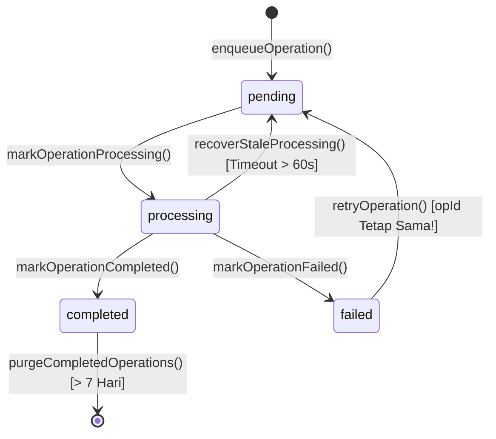

# LAPORAN PELAKSANAAN FASE 2: OFFLINE QUEUE & IDEMPOTENCY

**Proyek:** Catatan Warung Madura  
**Firebase Project ID:** `catatan-b7384`  
**Status Eksekusi:** FASE 2 SELESAI (100% SUKSES) — MENUNGGU REVIEW GATE 3  
**Tanggal Eksekusi:** 20 November 2026  
**Dasar Acuan:** `ROADMAP-IMPLEMENTASI-FIREBASE-CATATAN-WARUNG-FINAL.md`

---

## 1. RINGKASAN IMPLEMENTASI

Fase 2 telah berhasil diimplementasikan secara penuh untuk membangun fondasi antrean operasi lokal yang persisten, aman terhadap gangguan siklus hidup browser (*reload*, *crash*, penutupan tab), dan memiliki mekanisme idempotensi lokal berbasis `opId` unik dan *collision-resistant*.

Implementasi ini dilaksanakan dengan mematuhi secara ketat **Batasan Mutlak Fase 2**:
1. **Tidak Menulis/Membaca Sinkronisasi ke Firestore:** Antrean IndexedDB dibangun sebagai fondasi penampung operasi mandiri. Belum ada koneksi sinkronisasi otomatis ke Firestore (sinkronisasi adalah domain Fase 3).
2. **Tidak Memindahkan Data `localStorage`:** Penyimpanan operasional lokal (`wm_v1_*`) tetap menjadi sumber kebenaran (*primary operational storage*) yang aktif 100% bagi seluruh modul transaksi, kasir, stok, dan laporan.
3. **Tidak Mempublikasikan Security Rules Produksi:** Firestore Security Rules tetap berada di repositori lokal dan emulator; tidak ada tombol *Publish* yang ditekan di Firebase Console.
4. **Tidak Mengubah Logika Bisnis:** Perhitungan stok, konversi satuan, penerimaan barang, pencatatan transaksi, dan alur aplikasi tidak dimodifikasi.
5. **Kejujuran Arsitektur Idempotensi:** Sistem secara tegas membedakan *Local Idempotency* (yang diselesaikan pada Fase 2) dengan *Server Idempotency* (yang akan diselesaikan pada transaksi atomik Firestore Fase 3). Fase 2 menjamin kontrak `opId` yang tidak akan berubah saat *retry*.

---

## 2. ARSITEKTUR OFFLINE QUEUE & SKEMA INDEXEDDB

Layanan antrean diimplementasikan dalam modul mandiri [src/services/offlineQueue.js](file:///d:/catatan/src/services/offlineQueue.js) berbasis API standar browser `indexedDB`.

### A. Parameter Basis Data
- **Nama Basis Data:** `catatan_warung_offline_queue`
- **Versi Skema:** `1`
- **Object Store Utama:** `operations`
- **Kunci Utama (`keyPath`):** `opId` (tipe data: *string*)

### B. Indeks Pencarian (Indexes)
Untuk mendukung efisiensi query dan isolasi multi-pengguna tanpa membaca seluruh isi tabel ke memori, disusun 5 indeks sekunder:
1. `by_ownerUid` (`ownerUid`): Filter seluruh operasi milik satu akun pemilik tertentu.
2. `by_status` (`status`): Filter operasi berdasarkan status siklus hidupnya (`pending`, `processing`, `completed`, `failed`).
3. `by_owner_status` (`[ownerUid, status]`): *Compound index* efisien untuk membaca antrean `pending` khusus pemilik yang sedang aktif tanpa melakukan penyaringan memori (*in-memory filter*).
4. `by_createdAt` (`createdAt`): Menjaga keterurutan waktu operasi antrean secara kronologis (*FIFO - First-In-First-Out*).
5. `by_entity` (`entity`): Mengelompokkan operasi berdasarkan modul domain (`transactions`, `products`, `movements`, `debts`, dll).

### C. Mekanisme Pemulihan Koneksi & Versioning
- Fungsi internal `getDb()` mengelola siklus koneksi secara aman.
- Apabila terjadi *browser upgrade* atau skema baru di masa depan, *event* `onupgradeneeded` menangani pembuatan struktur tabel dan indeks tanpa merusak data lama.

---

## 3. STRUKTUR AMPLOP OPERASI & MEKANISME OPID

Setiap aksi bisnis yang dimasukkan ke dalam antrean dibungkus dalam sebuah *Amplop Operasi Terstandarisasi* (*Standardized Operation Envelope*).

### A. Generator `opId` & Karakteristik
Format identifikasi operasi:
```javascript
const opId = `op_${timestamp}_${random8char}`;
// Contoh: op_1795147682429_qk3uc5ak
```
Karakteristik teknis `opId`:
- **Collision-Resistant:** Menggabungkan milidetik resolusi tinggi (*monotonic timestamp*) dan 8 karakter acak alfanumerik berbasis *base-36*. Teruji 500 pemanggilan berturut-turut menghasilkan 500 ID unik tanpa kolisi.
- **Kronologis Parsial:** Membantu pengurutan alami berdasarkan waktu penciptaan.
- **Immutabel (Kekal):** Sekali sebuah operasi diciptakan, `opId` tidak boleh diubah atau diganti baru, termasuk saat mengalami kegagalan dan dipicu untuk *retry*.

### B. Spesifikasi Amplop Operasi
```javascript
{
  opId: "op_1795147682429_qk3uc5ak",       // String unik dan kekal
  ownerUid: "uid_pemilik_firebase_123",    // Identitas pemilik dari Firebase Auth
  entity: "transactions",                 // Domain entitas
  action: "create",                       // create | update | delete
  payload: {                              // Data bisnis lengkap tanpa mutasi
    id: "TRX-001",
    total: 45000,
    items: [...]
  },
  clientTimestamp: "2026-11-20T04:00:00.000Z", // Timestamp ISO klien
  operatorSnapshot: {                     // Snapshot operator bertugas
    operatorId: "op_adik",
    operatorName: "Adik"
  },
  status: "pending",                      // pending | processing | completed | failed
  retryCount: 0,                          // Jumlah percobaan ulang
  createdAt: 1795147682429,               // Timestamp numerik pembuat
  updatedAt: 1795147682429,               // Timestamp numerik pembaruan terakhir
  lastError: null                         // Catatan kegagalan jika ada
}
```

### C. Snapshot Operator Immutabel
- Atribut `operatorSnapshot` mengunci nama dan ID operator kasir yang sedang bertugas saat operasi dicatat.
- Atribut ini **tidak mengubah dan tidak menggantikan** `ownerUid`. Hal ini memastikan isolasi kepemilikan tetap merujuk pada akun Google pemilik warung, sementara catatan audit kasir tetap akurat selamanya.

---

## 4. SIKLUS HIDUP OPERASI & PEMULIHAN KEGAGALAN



### A. Definisi Status Operasi
1. `pending`: Operasi baru dicatat dan menunggu pemrosesan oleh sinkronizer.
2. `processing`: Operasi sedang diambil oleh pemroses antrean untuk dikirimkan.
3. `completed`: Operasi telah sukses diproses dan dikonfirmasi server. Terkunci rapat dan menolak penulisan ulang.
4. `failed`: Operasi mengalami kegagalan kritis atau melampaui batas toleransi koneksi. Tersimpan dengan riwayat `lastError`.

### B. Ketahanan Terhadap Browser Crash (*Stale Processing Recovery*)
Apabila browser ditutup mendadak, tab ditutup paksa, atau perangkat mati saat sebuah operasi berstatus `processing`, operasi tersebut tidak akan hilang atau macet selamanya.
- Modul menyediakan fungsi:
  ```javascript
  recoverStaleProcessingOperations(ownerUid, staleTimeoutMs = 60000)
  ```
- Setiap operasi yang berada pada status `processing` lebih lama dari ambang batas (default: 60 detik) secara otomatis dikembalikan ke status `pending` agar dapat dicoba kembali pada siklus berikutnya.

### C. Kebijakan Retry Terkontrol
- Fungsi `retryOperation(opId)` menaikkan `retryCount` sebanyak 1, membersihkan `lastError`, dan mengembalikan status ke `pending`.
- **Ketentuan Mutlak:** `opId` asli dipertahankan secara utuh. Sistem dilarang membuat `opId` baru pada saat *retry*, agar server pada Fase 3 dapat mengenali pengiriman ulang ini sebagai operasi yang sama (*idempotent replay*).

### D. Kebijakan Retensi & Pembersihan
- Operasi berstatus `completed` dipertahankan sementara waktu untuk audit dan deduplikasi.
- Fungsi `purgeCompletedOperations(ownerUid, maxAgeMs = 7 * 24 * 3600 * 1000)` hanya membersihkan entri `completed` yang berusia lebih dari 7 hari.
- Fungsi pembersihan **tidak pernah** menghapus operasi yang berstatus `pending` atau `failed`.

---

## 5. MEKANISME IDEMPOTENSI: LOKAL VS SERVER

Arsitektur Fase 2 memisahkan batasan tanggung jawab idempotensi secara tegas:

| Dimensi | Idempotensi Lokal (Fase 2) | Idempotensi Server (Fase 3) |
| :--- | :--- | :--- |
| **Media Penyimpanan** | IndexedDB (`operations` store) | Firestore Cloud (`/owners/{uid}/operations_log`) |
| **Mekanisme Deteksi** | Pengecekan `get(opId)` sebelum `put()` | Firestore `runTransaction()` atomic check |
| **Perilaku Duplikasi** | Mengembalikan record yang sudah ada tanpa menimpa (*no-op duplicate*) | Mengabaikan mutasi stok jika `opId` sudah tercatat di log transaksi |
| **Perilaku Retry** | Mempertahankan `opId` yang sama persis | Mendeteksi bahwa paket data adalah pengiriman ulang yang sah |
| **Status Realisasi** | **Telah Teruji 100% di Fase 2** | **Akan Diimplementasikan di Fase 3** |

---

## 6. INTEGRASI UI DIAGNOSTIK PENGATURAN

Untuk mempermudah verifikasi dan pengawasan teknis tanpa membingungkan pemilik warung, ditambahkan kartu diagnostik minimal pada [src/pages/Pengaturan.jsx](file:///d:/catatan/src/pages/Pengaturan.jsx) (Seksi 4):
- **Tampilan Metrik Ringkas:** Menampilkan 4 lencana status:
  - Antrean Tertunda (*Pending*)
  - Sedang Diproses (*Processing*)
  - Berhasil Disinkronkan (*Completed*)
  - Gagal / Butuh Perhatian (*Failed*)
- **Tombol Muat Ulang Status:** Memanggil `getQueueStats(ownerUid)` secara asinkron tanpa memuat ulang seluruh halaman.
- **Kepatuhan Desain:**
  - Tidak menampilkan indikator sinkronisasi palsu (*fake sync*).
  - Memberikan keterangan jelas bahwa antrean adalah penyimpanan lokal persiapan sinkronisasi cloud.
  - Tampilan rapi, senada dengan tema UI aplikasi, dan tersembunyi dengan aman di tab Pengaturan Data.

---

## 7. HASIL PENGUJIAN VERIFIKASI AKTUAL

Seluruh verifikasi dijalankan menggunakan skrip pengujian otomatis mandiri dan emulator.

### A. Hasil Test Suite Fase 2 (`npm run test:fase2`)
File pengujian: [scripts/test-fase2-queue.mjs](file:///d:/catatan/scripts/test-fase2-queue.mjs)  
Hasil: **14/14 PASS (100% SUKSES)**

```text
=================================================================
   FASE 2: OFFLINE QUEUE & IDEMPOTENCY TEST SUITE (INDEXEDDB)   
=================================================================

--- UJI 1 & 2: Enqueue Operasi & Keunikan opId ---
✅ [Uji 1.1] Enqueue Operasi Berhasil ke IndexedDB -> PASS (opId: op_1795147682429_qk3uc5ak)
✅ [Uji 2.1] Generator opId Menghasilkan 500 ID Unik Berurutan Tanpa Kolisi -> PASS 

--- UJI 3: Integritas Payload Operasi ---
✅ [Uji 3.1] Payload Tersimpan Utuh Tanpa Degradasi atau Mutasi Objek -> PASS 

--- UJI 4: Ketahanan Reload Halaman (Tutup & Buka Ulang Koneksi) ---
✅ [Uji 4.1] Antrean Tetap Tersedia Utuh Setelah Koneksi Ditutup & Dibuka Ulang -> PASS 

--- UJI 5: Simulasi Browser Restart (Storage Persistence Check) ---
✅ [Uji 5.1] Persistensi Fisik IndexedDB Terverifikasi (Bukan Variabel Array Memori Sesaat) -> PASS (Total operasi persisten: 1)

--- UJI 6 & 7: Idempotensi & Retry Preservation ---
✅ [Uji 6.1] Retry Mempertahankan opId Asli yang Sama Murni (Tanpa Membuat ID Baru) -> PASS (opId tetap: op_retry_test_fixed_123, retryCount: 1)
✅ [Uji 7.1] Enqueue Ulang opId yang Sama Berhasil Di-Deduplikasi Tanpa Menimpa Data Asli -> PASS (Tepat 1 entri dipertahankan)

--- UJI 8: Proteksi Operasi Completed ---
✅ [Uji 8.1] Operasi Completed Terkunci Rapat, Tidak Masuk Pending, & Menolak Re-Enqueue -> PASS 

--- UJI 9: Pemulihan Status Processing Tertinggal ---
✅ [Uji 9.1] Pemulihan Otomatis Operasi Stale Processing Kembali Menjadi Pending Berhasil -> PASS (Dipulihkan: 1 operasi)

--- UJI 10: Peninjauan Operasi Gagal & Kebijakan Retensi ---
✅ [Uji 10.1] Operasi Gagal Tersimpan Utuh Beserta Alasan Error untuk Audit Pengguna -> PASS (lastError: Koneksi Firestore Timeout)

--- UJI 11: Penanganan Error Input & Validasi IndexedDB ---
✅ [Uji 11.1] Seluruh Input Cacat Tertangkap Validasi Tanpa Menyebabkan Unhandled Exception -> PASS (Validasi input lengkap)

--- UJI 12: Isolasi Data Antar-UID Pemilik ---
✅ [Uji 12.1] Isolasi Mutlak: Antrean Alice Tidak Bocor ke Bob dan Sebaliknya -> PASS 

--- UJI 13: Konsistensi Snapshot Operator ---
✅ [Uji 13.1] Snapshot Operator (Adik) Terkunci Permanen Tanpa Mengubah Atribut ownerUid -> PASS (operatorName: Adik, ownerUid: uid_alice_owner_123)

--- UJI 14: Ketahanan Kegagalan Transaksi Status ---
✅ [Uji 14.1] Status Update Tidak Valid Ditolak Aman Tanpa Merusak Data Antrean Lain -> PASS 

=================================================================
TOTAL PENGUJIAN: 14 | LULUS: 14 | GAGAL: 0 | STATUS: 100% PASS
=================================================================
```

### B. Uji Regresi Fase 0 (Firestore Rules Emulator)
Perintah: `npm run test:rules`  
Hasil: **33/33 PASS (100% SUKSES, Nol Regresi)**

### C. Uji Regresi Fase 1 (Authentication & Cloud Backup Compatibility)
Perintah: `npm run test:fase1`  
Hasil: **14/14 PASS (100% SUKSES, Nol Regresi)**

### D. Uji Kompilasi & Build Produksi
Perintah: `npm run build`  
Hasil: **Sukses dibangun dalam 3.85 detik** (1987 modul Vite tertransformasi tanpa ada *syntax error* atau *broken imports*).

---

## 8. DAFTAR FILE YANG DIBUAT / DIUBAH

| File | Status | Keterangan |
| :--- | :--- | :--- |
| [src/services/offlineQueue.js](file:///d:/catatan/src/services/offlineQueue.js) | Baru | Modul layanan IndexedDB offline queue (skema v1, 5 indeks, enkapsulasi status, generator `opId`, *stale recovery*, *purge*, dan validasi ketat). |
| [scripts/test-fase2-queue.mjs](file:///d:/catatan/scripts/test-fase2-queue.mjs) | Baru | Skrip pengujian otomatis 14 skenario ketat Fase 2 menggunakan `fake-indexeddb`. |
| [src/pages/Pengaturan.jsx](file:///d:/catatan/src/pages/Pengaturan.jsx) | Diubah | Integrasi kartu diagnostik antrean offline (Seksi 4) dengan lencana reaktif dan tombol muat ulang status. |
| [package.json](file:///d:/catatan/package.json) | Diubah | Penambahan devDependency `fake-indexeddb` (^6.2.8) dan perintah npm `"test:fase2"`. |
| [package-lock.json](file:///d:/catatan/package-lock.json) | Diubah | Penguncian dependensi `fake-indexeddb`. |

---

## 9. ANALISIS RISIKO & BATASAN

1. **Keterbatasan Penyimpanan Browser:**
   - IndexedDB bergantung pada kuota penyimpanan browser pengguna. Jika perangkat pengguna kehabisan ruang disk, browser dapat menolak penambahan antrean baru.
   - *Mitigasi:* Sistem telah dilengkapi fungsi `purgeCompletedOperations` untuk membuang entri sukses yang sudah melampaui masa retensi 7 hari.
2. **Keterisolasian Antrean (Belum Tersambung ke Jaringan):**
   - Pada Fase 2 ini, antrean hanya bertindak sebagai *storage & lifecycle coordinator*. Belum ada *event listener* jaringan (`navigator.onLine`) atau *worker* yang mencoba melakukan transmisi data ke Firestore.
   - *Mitigasi:* Hal ini sengaja dibatasi sesuai roadmap agar Fase 2 terverifikasi tuntas secara deterministik sebelum sinkronisasi Fase 3 dibangun.
3. **Pembersihan Cache Manual oleh Pengguna:**
   - Jika pengguna sengaja menekan "Clear Site Data" di pengaturan browser, data IndexedDB lokal akan terhapus.
   - *Mitigasi:* Seluruh data operasional utama tetap aman di `localStorage`. Pada Fase 3, setelah data berhasil dikirim ke Firestore, pembersihan cache lokal tidak akan menghilangkan data di cloud.

---

## 10. KONFIRMASI NOL DAMPAK PRODUKSI & KESIAPAN GATE 3

- **Database Firestore Produksi:** **TIDAK TERSENTUH (NOL PENULISAN).**
- **Firestore Security Rules Produksi:** **TIDAK DIPUBLIKASIKAN.**
- **Penyimpanan Operasional `localStorage`:** **100% AMAN DAN AKTIF.**
- **Kesiapan Gate 3:**
  - Fondasi `opId` telah terbukti kekal dan unik.
  - Siklus status `pending` $\rightarrow$ `processing` $\rightarrow$ `completed` / `failed` telah teruji kokoh.
  - Kode dan dependensi telah siap menjadi landasan integrasi sinkronisasi Firestore pada Fase 3.

**Rekomendasi:** Fase 2 dinyatakan **SELESAI DENGAN SEMPURNA**. Tim siap mempresentasikan hasil ini kepada pemilik proyek dan menunggu persetujuan Gate 3 sebelum melangkah ke Fase 3.
