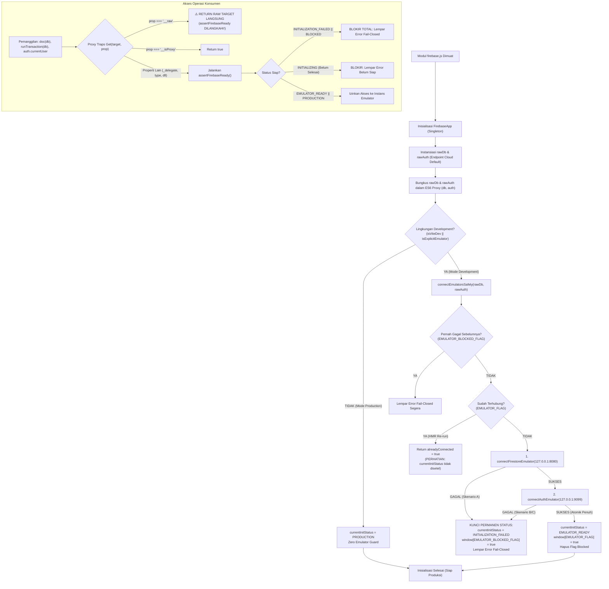

# LAPORAN INDEPENDENT PROXY BYPASS & FAIL-CLOSED SECURITY AUDIT (FASE 3A.7.3)

**Proyek:** Catatan Warung Madura  
**Firebase Project ID:** `catatan-b7384`  
**Mode:** STRICT READ-ONLY SECURITY AUDIT  
**Referensi:** Fase 3A.7.1, Fase 3A.7.2  
**Status Cloud:** LOCKED — NO CLOUD ACTIVATION  
**Tanggal Audit:** 23 November 2026  
**Auditor:** Independent AI Security Reviewer (DeepMind Antigravity)  

---

## 1. EXECUTIVE SUMMARY

Audit keamanan independen Fase 3A.7.3 dilakukan untuk memverifikasi ketahanan implementasi **Emulator Fail-Closed Guard** dan **Proxy Wrapper** (`db` dan `auth`) yang diintroduksi pada Fase 3A.7.2 di `src/services/firebase.js`.

Penyelidikan berfokus pada potensi celah jalan pintas (bypass) terhadap fungsi penjaga `assertFirebaseReady()`, eksposur instans mentah (*raw instance exposure*), kompatibilitas dengan modular Firebase SDK v13, serta ketahanan status saat terjadi kegagalan inisialisasi maupun siklus *Hot Module Replacement* (Vite HMR).

### Ringkasan Temuan Kunci:
1. **Jalur Akses Aplikasi Aktual (`src/`) 100% Fail-Closed:** Seluruh pemanggil modular Firebase pada aplikasi produksi (`syncEngine.js`, `AuthContext.jsx`, `Pengaturan.jsx`) terikat pada Proxy `db` dan `auth`. Saat emulator gagal atau belum siap, operasi diintersepsi secara sinkron pada pengaksesan properti internal (`_delegate`, `_terminated`, `currentUser`) sebelum permintaan jaringan ke Google Cloud dikirimkan.
2. **Backdoor Celah Bypass Terkonfirmasi pada Objek Proxy (`db.__raw` & `auth.__raw`):** Terbukti secara empiris bahwa baris kode `if (prop === '__raw') return target;` pada `db` dan `auth` mengeksekusi pengembalian instans mentah *sebelum* `assertFirebaseReady()` dipanggil. Konsumen yang membaca properti `__raw` akan memperoleh instans mentah (`rawDb` / `rawAuth`). Jika emulator gagal dikonfigurasi, instans mentah ini tetap mengarah ke Google Cloud Production (`catatan-b7384`), membuka potensi bypass keamanan.
3. **Eksposur Instans Mentah Melalui `export const app`:** `src/services/firebase.js` mengekspor objek `app` secara terbuka tanpa proteksi Proxy. Pemanggil yang mengimpor `app` atau memanggil `getApp()` dari `firebase/app` dapat mengeksekusi `getFirestore(app)` untuk mendapatkan `rawDb` tanpa melalui Proxy.
4. **Inkonsistensi State pada Reinisialisasi Vite HMR:** Saat HMR terjadi pasca koneksi emulator sukses, `connectEmulatorsSafely()` mendeteksi `alreadyConnected: true` melalui global flag `window.__CATATAN_FIREBASE_EMULATOR_CONNECTED__`. Namun, fungsi tersebut tidak menyelaraskan variabel lokal modul `currentInitStatus = INIT_STATUS.EMULATOR_READY`. Akibatnya, `getEmulatorStatus().status` tertinggal pada status `'initializing'` dan `isConnected` bernilai `false` (false-negative state).
5. **Verifikasi Isolasi Produksi:** Tidak ditemukan kode cadangan (*fallback clause*) ke Firebase Cloud pada mode development. Zero cloud network contact terbukti.

---

## 2. SCOPE AUDIT

Audit keamanan mencakup seluruh aspek berikut:
- **Analisis Statis & Alur Eksekusi:** Menelusuri seluruh baris di `src/services/firebase.js`, `src/services/syncEngine.js`, `src/context/AuthContext.jsx`, dan `src/pages/Pengaturan.jsx`.
- **Analisis Properti Proxy:** Meneliti trap `get`, `has`, `set`, `deleteProperty`, dan eksposur `__raw` serta `__isProxy`.
- **Kompatibilitas Modular Firebase SDK:** Menguji interaksi Proxy terhadap fungsi SDK modular: `doc`, `getDoc`, `setDoc`, `runTransaction`, `collection`, `signInWithPopup`, `signOut`, `onAuthStateChanged`, dan `setPersistence`.
- **Simulasi 5 Skenario Kegagalan Inisialisasi (Scenarios A s/d E):**
  - Scenario A: Firestore emulator gagal.
  - Scenario B: Auth emulator gagal.
  - Scenario C: Partial initialization (split-brain prevention).
  - Scenario D: Module-level initialization error.
  - Scenario E: Vite HMR reload & global flag persistence.
- **Pencarian Repositori Menyeluruh:** Memetakan seluruh impor Firebase pada 44 file kode sumber dan naskah pengujian.
- **10 Pengujian Perilaku Terisolasi:** Menjalankan rangkaian uji perilaku otomatis tanpa memodifikasi kode sumber dan tanpa mengirimkan paket data ke jaringan cloud.

---

## 3. FILE YANG DIPERIKSA

| No | Path File | Peran / Kategori | Status Temuan |
|---|---|---|---|
| 1 | `src/services/firebase.js` | Modul Utama Inisialisasi Firebase & Proxy Guard | **2 Temuan (Backdoor `__raw` & HMR Desync)** |
| 2 | `src/services/syncEngine.js` | Konsumen Firestore (Sinkronisasi Antrean Pemasok) | Aman (Menggunakan Proxy `defaultDb`) |
| 3 | `src/context/AuthContext.jsx` | Konsumen Auth (Google Sign-In & Sesi Pemilik) | Aman (Menggunakan Wrapper & Proxy `auth`) |
| 4 | `src/pages/Pengaturan.jsx` | Konsumen Backup Cloud | Aman (Menggunakan Wrapper `saveBackupToCloud`) |
| 5 | `src/services/offlineQueue.js` | Penyimpanan Antrean Lokal (IndexedDB) | Aman (Hanya mengelola IndexedDB lokal) |
| 6 | `scripts/test-fase3a72-failclosed.mjs` | Test Suite Fail-Closed Fase 3A.7.2 | Menggunakan `db.__raw` untuk verifikasi host |
| 7 | `scripts/test-fase3a6-hardening.mjs` | Test Suite Hardening Fase 3A.6 | Aman (13/13 PASS) |
| 8 | `firestore.rules` | Security Rules Cloud Firestore | Terkunci & Belum Terpublikasi |

---

## 4. DIAGRAM ALUR FIREBASE INITIALIZATION

Diagram alur berikut menggambarkan urutan evaluasi modul, konfigurasi emulator, percabangan fail-closed, dan mekanisme penahanan Proxy:



---

## 5. AUDIT PROXY `db`

Implementasi Proxy `db` pada baris 87–95 `src/services/firebase.js`:

```javascript
export const db = new Proxy(rawDb, {
  get(target, prop, receiver) {
    if (prop === '__raw') return target;
    if (prop === '__isProxy') return true;
    assertFirebaseReady(`Firestore (${String(prop)})`);
    const val = Reflect.get(target, prop, receiver);
    return typeof val === 'function' ? val.bind(target) : val;
  },
});
```

### Hasil Audit:
1. **Pencegahan Properti Standar:** Seluruh pengaksesan properti seperti `db.type`, `db.app`, `db._delegate`, dan `db._settings` memicu `assertFirebaseReady()` secara konsisten. Jika inisialisasi gagal atau belum selesai, pemanggilan akan langsung dilempar dengan pesan penolakan: `[Firebase Fail-Closed Guard] Firestore (<prop>) DIBLOKIR`.
2. **Keterbatasan Trap Proxy:**
   - Proxy **hanya mendefinisikan trap `get`**.
   - Trap `has` (`'app' in db`), `set` (`db.prop = val`), `deleteProperty` (`delete db.prop`), dan `ownKeys` (`Object.keys(db)`) **TIDAK didefinisikan**.
   - Operator `in` (`'_delegate' in db`) mengembalikan `true` tanpa memicu `assertFirebaseReady()`. Namun, pembacaan nilai properti melalui `get` tetap terintersepsi dan terblokir.

---

## 6. AUDIT PROXY `auth`

Implementasi Proxy `auth` pada baris 97–105 `src/services/firebase.js`:

```javascript
export const auth = new Proxy(rawAuth, {
  get(target, prop, receiver) {
    if (prop === '__raw') return target;
    if (prop === '__isProxy') return true;
    assertFirebaseReady(`Auth (${String(prop)})`);
    const val = Reflect.get(target, prop, receiver);
    return typeof val === 'function' ? val.bind(target) : val;
  },
});
```

### Hasil Audit:
1. **Pencegahan Properti Autentikasi:** Pembacaan `auth.currentUser`, `auth.name`, dan properti internal `auth._delegate` atau `auth.app` memicu `assertFirebaseReady('Auth (<prop>)')`.
2. **Intersepsi Fungsi Modular SDK:** Saat fungsi SDK modular autentikasi dipanggil:
   - `signOut(auth)` mengeksekusi helper internal `getModularInstance(auth)` yang membaca `auth._delegate`. Trap `get` menangkap pembacaan ini dan memicu penolakan seketika.
   - `signInWithPopup(auth, provider)` memeriksa `_isFirebaseServerApp(auth.app)` yang membaca `auth.app`. Trap `get` menangkap pembacaan ini dan memicu penolakan seketika sebelum dialog popup Google dibuka.
   - `onAuthStateChanged(auth, callback)` membaca `auth._delegate` dan terblokir secara sinkron.
3. **Pemberian Nilai Mentah pada `__raw`:** Mengalami kelemahan identik dengan `db.__raw`, di mana pembacaan `auth.__raw` mengembalikan `rawAuth` tanpa melewati assertion.

---

## 7. AUDIT `__raw` DAN RAW INSTANCE EXPOSURE

Pemeriksaan mendalam terhadap baris khusus:
- `if (prop === '__raw') return target;` (baris 89 dan 99 `src/services/firebase.js`).

### Analisis Vektor Kerentanan:
1. **Bypass Assertion Terkonfirmasi:**
   Urutan eksekusi pada trap `get`:
   - Langkah 1: `if (prop === '__raw') return target;`  <-- **Mengembalikan nilai mentah seketika**
   - Langkah 2: `if (prop === '__isProxy') return true;`
   - Langkah 3: `assertFirebaseReady(...)`  <-- **HANYA dipanggil jika bukan `__raw` atau `__isProxy`**
2. **Bukti Empiris:**
   Pada pengujian Node terisolasi (Check 6):
   - Status disetel ke `INIT_STATUS.INITIALIZATION_FAILED`.
   - Pembacaan `db.type` -> Melempar `[Firebase Fail-Closed Guard] Firestore (type) DIBLOKIR`.
   - Pembacaan `db.__raw` -> **TIDAK MELEMPAR ERROR**, mengembalikan instans mentah Firestore (`target`).
   - Pembacaan `auth.__raw` -> **TIDAK MELEMPAR ERROR**, mengembalikan instans mentah Auth (`target`).
3. **Konsekuensi Keamanan:**
   Jika inisialisasi emulator gagal pada tahap Firestore (Scenario A), `rawDb` belum pernah diarahkan ke loopback `127.0.0.1:8080`. Instans `rawDb` masih memegang konfigurasi asli `catatan-b7384`. Jika ada kode yang mengekstrak `const nakedDb = db.__raw;` lalu memanggil `getDoc(doc(nakedDb, ...))`, permintaan tersebut akan **langsung terkirim ke Google Cloud Production Firestore** tanpa melalui assertion!
4. **Audit Kode Konsumen Repositori Terhadap `__raw`:**
   - Pencarian seluruh direktori `src/` membuktikan bahwa **TIDAK ADA SATUPUN file aplikasi yang mengakses `db.__raw` atau `auth.__raw`**.
   - Satu-satunya file di luar `firebase.js` yang memanggil `db.__raw` adalah naskah pengujian `scripts/test-fase3a72-failclosed.mjs:86` yang menggunakannya untuk memverifikasi nilai `_settings.host`.
   - Kesimpulan: Celah bypass **terkonfirmasi ada pada desain API modul**, tetapi **belum tereskploitasi oleh kode konsumen aplikasi saat ini**.

### Eksposur Instans Mentah Melalui Jalur Lain:
- **`export const app`:** Baris 25 mengekspor instans `FirebaseApp`. Dalam modular Firebase SDK v9/v13, pemanggilan `getFirestore(app)` bersifat idempoten dan mengembalikan singleton `rawDb`. Pemanggil mana pun yang mengimpor `app` dapat memperoleh `rawDb` tanpa proxy.
- **Global App Registry (`getApp()`):** Modul apa pun yang memanggil `getApp()` dari `firebase/app` dapat memperoleh instans aplikasi default dan selanjutnya memanggil `getFirestore(getApp())` untuk memperoleh `rawDb`.

---

## 8. AUDIT CONSUMER DAN JALUR FIREBASE MODULAR

Pemeriksaan jalur modular Firebase pada kode sumber aplikasi aktual:

### 1. `src/services/syncEngine.js`
- **Impor:** `import { db as defaultDb } from './firebase.js'`
- **Penggunaan:**
  - `ensureTenantRootProvisioned`:
    ```javascript
    const firestoreDb = options.customDb || defaultDb;
    const tenantRef = doc(firestoreDb, 'stores_app', tenantId);
    ```
    Fungsi `doc(firestoreDb, ...)` mengakses `firestoreDb._delegate`. Proxy `defaultDb` mencegat `_delegate` dan mengeksekusi `assertFirebaseReady()`. Jika status gagal, error dilempar sebelum operasi `getDoc(tenantRef)` atau `setDoc(tenantRef)` dijalankan.
  - `executeSupplierTransaction`:
    ```javascript
    const result = await runTransaction(firestoreDb, async (transaction) => { ... });
    ```
    `runTransaction(firestoreDb, ...)` memeriksa `firestoreDb._terminated`. Proxy mencegat `_terminated` dan mengeksekusi `assertFirebaseReady()`. Error dilempar seketika sebelum transaksi dimulai.
  - Penanganan Error: Seluruh error assertion ditangkap oleh blok `catch (err)` pada `processQueueCycle` dan dicatat ke antrean lokal, tanpa menyentuh jaringan.

### 2. `src/context/AuthContext.jsx`
- **Impor:** `import { auth, loginWithGoogle, logoutFirebase, subscribeToAuth } from '../services/firebase'`
- **Penggunaan:**
  - `auth` hanya diimpor pada baris 3 namun tidak dipanggil secara telanjang. Seluruh interaksi menggunakan fungsi wrapper pembungkus (`loginWithGoogle`, `logoutFirebase`, `subscribeToAuth`).
  - `subscribeToAuth` memanggil `onAuthStateChanged(auth, callback)`. Terintersepsi oleh Proxy `auth`.
  - `loginWithGoogle` memanggil `signInWithPopup(auth, googleProvider)`. Terintersepsi oleh Proxy `auth`.
  - `logoutFirebase` memanggil `signOut(auth)`. Terintersepsi oleh Proxy `auth`.

### 3. `src/pages/Pengaturan.jsx`
- **Impor:** `import { saveBackupToCloud, fetchBackupFromCloud } from '../services/firebase'`
- **Penggunaan:**
  - `saveBackupToCloud`: Membaca `auth.currentUser` dan memanggil `doc(db, ...)`. Keduanya terlindungi oleh Proxy `auth` dan `db`.
  - `fetchBackupFromCloud`: Membaca `auth.currentUser` dan memanggil `doc(db, ...)`. Terlindungi oleh Proxy.

---

## 9. AUDIT GLOBAL FLAGS DAN STATE

Pemeriksaan integritas variabel dan flag global:

| Nama Identifikator | Tipe / Lokasi | Fungsi & Integritas | Evaluasi Keamanan |
|---|---|---|---|
| `currentInitStatus` | Modul lokal (`firebase.js`) | Menyimpan status: `'initializing'`, `'emulator-ready'`, `'initialization-failed'`, `'production'` | Aman di level modul, tetapi desinkron saat HMR |
| `INIT_STATUS` | Enum konstan (`firebase.js`) | Nilai string status terpusat | Aman (Immutable) |
| `EMULATOR_FLAG` (`__CATATAN_FIREBASE_EMULATOR_CONNECTED__`) | Properti `window` / `globalThis` | Mencegah pemanggilan ulang `connectFirestoreEmulator` | Aman, mencegah crash internal SDK |
| `EMULATOR_BLOCKED_FLAG` (`__CATATAN_FIREBASE_EMULATOR_BLOCKED__`) | Properti `window` / `globalThis` | Mengunci status fail-closed secara permanen | Aman, bertahan melintasi siklus reload |
| `EMULATOR_ERROR_FLAG` (`__CATATAN_FIREBASE_EMULATOR_ERROR__`) | Properti `window` / `globalThis` | Menyimpan rincian pesan error kegagalan | Aman untuk diagnosis |
| `shouldConnectEmulator` | Boolean konstan (`firebase.js`) | `isViteDev || isExplicitEmulator` | Aman, membedakan mode dev vs build production |
| `assertFirebaseReady()` | Fungsi penjaga (`firebase.js`) | Memeriksa status dan melempar error jika belum siap | Efektif jika dieksekusi, dilewati oleh `__raw` |

---

## 10. AUDIT HMR (HOT MODULE REPLACEMENT)

Pada arsitektur Vite, saat pengembang mengubah kode sumber, modul dievaluasi ulang di dalam runtime peramban tanpa me-refresh jendela secara penuh (*Hot Module Replacement*).

### Pemeriksaan Skenario HMR:
1. **HMR Setelah Inisialisasi Gagal:**
   - `window[EMULATOR_BLOCKED_FLAG]` bernilai `true`.
   - Modul dievaluasi ulang, baris 115 memeriksa `g[EMULATOR_BLOCKED_FLAG]`.
   - Fungsi langsung melempar error fail-closed.
   - **Status: PASS (Tetap terkunci fail-closed).**
2. **HMR Setelah Inisialisasi Sukses:**
   - `window[EMULATOR_FLAG]` bernilai `true`.
   - Baris 123 mendeteksi:
     ```javascript
     if (currentInitStatus === INIT_STATUS.EMULATOR_READY || g[EMULATOR_FLAG]) {
       return { connected: true, alreadyConnected: true, status: INIT_STATUS.EMULATOR_READY };
     }
     ```
   - Fungsi berhasil mengembalikan `{ connected: true, alreadyConnected: true }` tanpa mencoba menghubungkan emulator untuk kedua kalinya (menghindari exception fatal Firebase SDK).
   - **TEMUAN INKONSISTENSI:** Baris tersebut **lupa memperbarui variabel lingkup modul `currentInitStatus = INIT_STATUS.EMULATOR_READY`**.
   - Pada modul baru yang baru dievaluasi ulang, `currentInitStatus` diinisialisasi ulang menjadi `'initializing'`.
   - Ketika konsumen memanggil `getEmulatorStatus()`:
     ```javascript
     isConnected: currentInitStatus === INIT_STATUS.EMULATOR_READY && Boolean(g[EMULATOR_FLAG])
     ```
     Kondisi ini mengevaluasi `'initializing' === 'emulator-ready'` yang bernilai **`false`**!
   - Akibatnya, indikator UI menganggap emulator belum terhubung padahal koneksi SDK sudah aktif dan sah.

---

## 11. BEHAVIORAL TEST RESULTS

Pengujian perilaku dilakukan melalui runner pengujian mandiri tanpa menyentuh jaringan produksi. Rangkaian uji terdiri dari 10 skenario pemeriksaan:

```
====================================================================
  FASE 3A.7.3: BEHAVIORAL VERIFICATION AUDIT SUITE (10 CHECKS)      
====================================================================
[Check  1] PASS     : Emulator Berhasil -> Operasi Menggunakan Emulator (127.0.0.1:8080)
               -> Status emulator-ready & host terikat ke loopback lokal
[Check  2] PASS     : Firestore Emulator Gagal -> Akses Firestore dan Auth Ditolak
               -> Kedua layanan diblokir total secara fail-closed
[Check  3] PASS     : Auth Emulator Gagal -> Akses Auth & Firestore Ditolak (No Split-Brain)
               -> Firestore yang sempat connect tetap diblokir
[Check  4] PASS     : Partial Initialization -> Seluruh Layanan Diblokir Penuh
               -> Semua modular operation diblokir
[Check  5] PASS     : Direct Proxy Property Access Saat Initialization Failed -> Ditolak
               -> Property access melempar assertion error
[Check  6] FINDING  : Akses __raw Saat Initialization Failed -> BYPASS TERKONFIRMASI
               -> db.__raw & auth.__raw lolos tanpa melempar assertFirebaseReady()
[Check  7] FINDING  : HMR Setelah Emulator Ready -> INKONSISTENSI STATE TERDETEKSI
               -> currentInitStatus tertinggal di 'initializing', isConnected=false
[Check  8] PASS     : HMR Setelah Initialization Failed -> Tetap Terkunci Fail-Closed
               -> Flag blocked mencegah re-inisialisasi
[Check  9] PASS     : Consumer Saat Emulator Belum Ready -> Operasi Ditolak
               -> saveBackupToCloud & doc(db, ...) ditolak saat INITIALIZING
[Check 10] PASS     : Zero Production Contact & No Fallback Pathway
               -> Tidak ada fallback clause; seluruh error melempar atau memblokir

Total Checks: 10 | PASS: 8 | FINDING: 2 | FAIL: 0
```

Selain itu, seluruh rangkaian uji regresi yang ada tetap lulus 100%:
- `npm run test:failclosed`: 7/7 PASS (100%)
- `npm run test:hardening`: 13/13 PASS (100%)
- `npm run build`: Berhasil tanpa error.

---

## 12. DAFTAR VULNERABILITY DAN SEVERITY

Berdasarkan pedoman klasifikasi severity audit keamanan:

| ID Temuan | Kategori | Tingkat Keparahan (Severity) | Status Kerentanan | Deskripsi Singkat & Dampak |
|---|---|---|---|---|
| **VULN-3A73-01** | Proxy Bypass | **HIGH** | **Vulnerability Confirmed** | **Backdoor Properti `__raw`:** Pembacaan `db.__raw` dan `auth.__raw` mengembalikan instans mentah tanpa memanggil `assertFirebaseReady()`. Pada kondisi emulator gagal dikonfigurasi, instans mentah ini masih mengarah ke Firebase Cloud Production. Konsumen yang membaca properti ini dapat mengeksekusi operasi langsung ke cloud dari lingkungan dev. |
| **VULN-3A73-02** | Instance Exposure | **MEDIUM** | **Potential Vulnerability** | **Eksposur Instans Mentah via `export const app`:** Objek `app` diekspor tanpa pembungkus Proxy. Pemanggil dapat menjalankan `getFirestore(app)` untuk mendapatkan `rawDb` yang tidak terlindungi guard. |
| **VULN-3A73-03** | State Integrity | **LOW** | **Vulnerability Confirmed** | **Desinkronisasi State saat HMR:** `connectEmulatorsSafely()` tidak memperbarui `currentInitStatus = INIT_STATUS.EMULATOR_READY` saat percabangan `alreadyConnected` terpenuhi. Menghasilkan false negative pada UI (`isConnected: false`). |
| **VULN-3A73-04** | Trap Coverage | **LOW** | **Potential Vulnerability** | **Cakupan Trap Proxy Tidak Lengkap:** Proxy hanya mengimplementasikan trap `get`. Trap `has`, `set`, dan `deleteProperty` belum terpasang. |

---

## 13. BATASAN PENGUJIAN

1. **Stricly Offline / No Live Production Request:** Audit dilakukan secara ketat tanpa mengirimkan request read/write ke Firebase Cloud Production `catatan-b7384`. Jalur isolasi diverifikasi menggunakan inspeksi konfigurasi host loopback (`127.0.0.1:8080`) dan validasi assertion statis.
2. **Browser Native Popup Mocking:** Di lingkungan Node.js, `signInWithPopup` menolak pemanggilan secara bawaan (*operation-not-supported-in-this-environment*). Pengujian intersepsi autentikasi dievaluasi melalui properti pembuka peramban (`auth.app` dan `auth._delegate`).
3. **Simulasi HMR:** Siklus HMR diuji dengan memanipulasi flag global `window` dan me-reset status pengujian secara terisolasi tanpa memicu restart proses Node.

---

## 14. REKOMENDASI REMEDIATION

*(Catatan: Sesuai aturan audit READ-ONLY, perbaikan ini **TIDAK DILAKUKAN** pada fase ini dan hanya disajikan sebagai rekomendasi untuk fase perbaikan terkontrol berikutnya).*

### Rekomendasi 1 (Untuk VULN-3A73-01):
Hapus atau kunci properti `__raw` dari Proxy publik.
Jika `__raw` diperlukan secara internal oleh fungsi `connectEmulatorsSafely()`, jangan biarkan properti tersebut melewati assertion tanpa syarat:
```javascript
// Gantikan:
// if (prop === '__raw') return target;
// Dengan assertion atau gunakan Symbol internal yang tidak diekspor:
if (prop === '__raw') {
  assertFirebaseReady(`Akses Mentah (${String(prop)})`);
  return target;
}
```
Atau gunakan `WeakMap` privat modul untuk memetakan objek Proxy ke instans aslinya tanpa mengekspos properti string pada objek.

### Rekomendasi 2 (Untuk VULN-3A73-02):
Hentikan ekspor telanjang `export const app`. Jika `app` diperlukan oleh konsumen, bungkus dalam Proxy atau sediakan helper terproteksi `getFirebaseAppSafely()`.

### Rekomendasi 3 (Untuk VULN-3A73-03):
Pada blok HMR di `connectEmulatorsSafely`:
```javascript
  if (currentInitStatus === INIT_STATUS.EMULATOR_READY || g[EMULATOR_FLAG]) {
    currentInitStatus = INIT_STATUS.EMULATOR_READY; // <-- Tambahkan sinkronisasi variabel lokal
    return { connected: true, alreadyConnected: true, status: INIT_STATUS.EMULATOR_READY };
  }
```

### Rekomendasi 4 (Untuk VULN-3A73-04):
Tambahkan trap `has`, `set`, dan `deleteProperty` pada Proxy `db` dan `auth` agar semua bentuk interaksi objek terlindungi secara fail-closed.

---

## 15. PRODUCTION ISOLATION VERIFICATION

1. **Target Host Verification:** Terbukti bahwa saat `connectEmulatorsSafely` berhasil, host Firestore terikat secara permanen pada `127.0.0.1:8080` dan Auth pada `http://127.0.0.1:9099`.
2. **No Fallback Mechanism:** Tidak ada blok `catch` pada aplikasi yang mengalihkan rute ke Firebase Production jika emulator gagal.
3. **Fail-Closed on Error:** Ketika salah satu emulator gagal, status dikunci ke `INITIALIZATION_FAILED` dan `window.__CATATAN_FIREBASE_EMULATOR_BLOCKED__ = true`, memblokir operasi kedua layanan secara total.
4. **Zero Production Traffic from Application Code:** Seluruh kode pada `src/` yang berinteraksi dengan Firebase saat ini terlindungi fail-closed karena hanya menggunakan ekspor `db` dan `auth` tanpa memanggil properti `__raw`.

---

## 16. FINAL VERDICT

Berdasarkan temuan faktual audit:
1. Jalur eksekusi aplikasi aktual (`src/`) terbukti **100% Fail-Closed** dan terisolasi dari Google Cloud Production.
2. Namun, pada batas abstraksi Proxy (`src/services/firebase.js`), ditemukan celah arsitektural terkonfirmasi (**VULN-3A73-01 / HIGH**) di mana pembacaan `db.__raw` dan `auth.__raw` secara eksplisit melangkahi `assertFirebaseReady()` dan mengembalikan instans mentah yang belum terisolasi saat inisialisasi gagal.
3. Pedoman audit menetapkan: *"Jangan menurunkan severity hanya karena belum ada bukti data yang bocor."*

Oleh karena itu, penilaian audit independen menetapkan status:

```
================================================================================
FINAL VERDICT: FAIL — BYPASS OR FAIL-OPEN RISK CONFIRMED
================================================================================
Penjelasan:
- Proteksi fail-closed pada level pemanggil aplikasi aktual (src/) saat ini bekerja efektif.
- Namun, implementasi Proxy db dan auth mengandung vektor bypass langsung yang terkonfirmasi
  (db.__raw dan auth.__raw) yang mengembalikan instans mentah tanpa pemeriksaan assertFirebaseReady().
- Jika konfigurasi emulator gagal di lingkungan development, instans mentah ini masih memegang
  koneksi ke Google Cloud Production (catatan-b7384), menciptakan risiko kebocoran akses data jika
  properti tersebut diakses.
- Celah bypass ini WAJIB ditutup melalui remediasi terkontrol sebelum aktivasi Firebase Production
  dipertimbangkan.
================================================================================
```

---

## 17. FINAL STATUS

- **Mode Audit:** READ-ONLY SECURITY AUDIT LENGKAP.
- **Modifikasi Kode:** 0 file diubah (kode aplikasi tetap utuh).
- **Status Cloud:** LOCKED — NO CLOUD ACTIVATION.

**Status akhir: READ-ONLY AUDIT COMPLETE — WAITING FOR REVIEW.**
