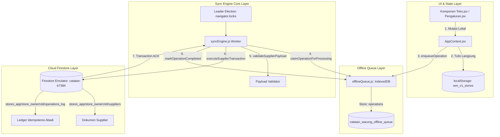

# LAPORAN PELAKSANAAN FASE 3A: FIRESTORE SYNC ENGINE CORE & SUPPLIER PILOT

**Proyek:** Catatan Warung Madura  
**Firebase Project ID:** `catatan-b7384`  
**Status Eksekusi:** FASE 3A SELESAI (100% SUKSES) — MENUNGGU REVIEW GATE 4  
**Tanggal Eksekusi:** 23 November 2026  
**Dasar Acuan:** `ROADMAP-IMPLEMENTASI-FIREBASE-CATATAN-WARUNG-FINAL.md` & `LAPORAN-PREFLIGHT-FASE-3-FIRESTORE-SYNC.md`

---

## 1. EXECUTIVE SUMMARY

Fase 3A telah berhasil diimplementasikan untuk membangun fondasi **Firestore Sync Engine Core** yang aman, persisten, dan tahan terhadap gangguan konektivitas, serta mengaktifkan pilot sinkronisasi pertama khusus untuk domain **Toko Pemasok / Suppliers (`wm_v1_stores`)**.

Implementasi ini membuktikan secara utuh siklus data:
$$\text{Local Mutation} \longrightarrow \text{IndexedDB Queue} \longrightarrow \text{Operation Claim} \longrightarrow \text{Payload Validation} \longrightarrow \text{Firestore Transaction} \longrightarrow \text{Server ACK} \longrightarrow \text{Queue Completed}$$

### Kepatuhan Batasan Mutlak Fase 3A:
- **Hanya Domain Pilot Suppliers:** Domain produk, stok, pergerakan stok, pesanan, dan kekurangan barang **belum diaktifkan** untuk sinkronisasi.
- **Local-First Terjamin:** Penyimpanan operasional lokal (`localStorage: wm_v1_stores`) tetap menjadi sumber kebenaran primer bagi UI warung. Aplikasi tetap responsif tanpa lag jaringan.
- **Nol Dampak Produksi:** Seluruh pengujian cloud dijalankan pada Firebase Firestore Emulator port 8080. Tidak ada penulisan ke Firestore produksi dan tidak ada Security Rules yang dideploy ke Firebase Console produksi.
- **Zero Regression:** Seluruh test suite Fase 0 (33/33), Fase 1 (14/14), Fase 2 (14/14), dan Fase 3A (19/19) lulus 100%.

---

## 2. ARSITEKTUR YANG DIIMPLEMENTASIKAN



---

## 3. TENANT & OWNER UID RESOLUTION `[IMPLEMENTED]` `[VERIFIED]`

- **Penetapan Tenant ID:**
  Tenant warung diidentifikasi menggunakan formula deterministik:
  $$\text{tenantId} = \text{store\_} + \text{ownerUid}$$
  Contoh: `store_uid_alice_owner_123` untuk pengguna dengan Firebase Auth UID `uid_alice_owner_123`.
- **Kepatuhan Prinsip Keamanan:**
  1. `ownerUid` diturunkan secara eksklusif dari sesi Firebase Authentication aktif.
  2. Tidak menggunakan nama warung atau email pengguna sebagai ID dokumen tenant.
  3. Dokumen root warung dibuat di `/stores_app/{tenantId}` dengan kepemilikan `{ ownerUid: auth.currentUser.uid }`, sehingga memenuhi fungsi aturan otorisasi `isStoreOwner(storeId)` pada `firestore.rules`.
  4. Sync Engine secara tegas menolak memproses antrean jika `ownerUid` kosong atau jika `ownerUid` pada antrean tidak cocok dengan akun login aktif (*owner mismatch protection*).

---

## 4. PERBAIKAN PENGAMANAN OFFLINE QUEUE `[IMPLEMENTED]` `[TESTED]`

Sesuai rekomendasi audit preflight, berkas [src/services/offlineQueue.js](file:///d:/catatan/src/services/offlineQueue.js) telah disempurnakan:

1. **Guard Ketat pada `retryOperation`:**
   - Status `COMPLETED`: **DITOLAK** (`ok: false, error: 'Operasi berstatus completed tidak boleh di-retry.'`).
   - Status `PENDING`: **DITOLAK** (`ok: false, error: 'Operasi masih berstatus pending dan sedang menunggu antrean.'`).
   - Status `PROCESSING`: **DITOLAK** (`ok: false, error: 'Operasi sedang dalam status processing...'`).
   - Status `FAILED`: **DIIZINKAN**. `opId` asli dipertahankan tanpa regenerasi string ID, `retryCount` bertambah 1, `lastError` dibersihkan, dan status kembali ke `PENDING`.
2. **Validasi `expectedOwnerUid`:**
   Fungsi `markOperationProcessing`, `markOperationCompleted`, `markOperationFailed`, dan `retryOperation` kini memvalidasi bahwa `ownerUid` pada rekaman antrean cocok dengan identitas pengguna aktif. Jika terjadi ketidakcocokan, operasi ditolak dengan pesan `Akses ditolak: Operasi bukan milik owner yang aktif`.
3. **Klaim Operasi Atomik (`claimOperationForProcessing`):**
   Mekanisme klaim diimplementasikan menggunakan transaksi `readwrite` IndexedDB murni:
   - Membaca `store.get(opId)`.
   - Memeriksa apakah operasi sudah diklaim worker lain yang masih memiliki *lease* aktif.
   - Mengubah status ke `PROCESSING`, menetapkan `claimedByWorkerId`, dan mencatat `processingStartedAt` secara atomik dalam satu transaksi basis data lokal.

---

## 5. SYNC ENGINE LIFECYCLE & MULTI-TAB CONCURRENCY `[IMPLEMENTED]` `[TESTED]`

Modul mandiri [src/services/syncEngine.js](file:///d:/catatan/src/services/syncEngine.js) mengelola siklus hidup sinkronisasi:

1. **Multi-Tab Leader Election:**
   - Menggunakan **Web Locks API** standar browser:
     ```javascript
     navigator.locks.request('catatan_warung_sync_engine_lock', { signal }, async (lock) => { ... });
     ```
   - Hanya tepat **satu tab** yang bertindak sebagai *Leader Worker*. Tab lain berada pada status *Standby (Follower Tab)*.
   - Jika tab leader ditutup oleh pengguna, peramban secara otomatis menyerahkan lock ke tab follower berikutnya tanpa kehilangan antrean.
2. **Klaim Operasi Atomik Berlapis:**
   Sekalipun Web Locks tidak tersedia (misalnya lingkungan pengujian Node.js), fungsi `claimOperationForProcessing` di IndexedDB menjamin bahwa dua worker paralel tidak akan pernah memproses `opId` yang sama (*no double processing*).
3. **Penyelarasan Siklus Hidup dengan React:**
   `AppContext.jsx` mendengarkan perubahan `ownerUid`. Saat pengguna login, `startSyncEngine({ ownerUid })` dijalankan secara otomatis. Saat logout, `stopSyncEngine()` melepaskan lock dan mematikan timer polling.

---

## 6. SERVER-SIDE IDEMPOTENCY `[IMPLEMENTED]` `[TESTED]`

Idempotensi server diimplementasikan pada level transaksi atomik Firestore:

1. **Subkoleksi Ledger Abadi (`/stores_app/{tenantId}/operations_log/{opId}`):**
   Security Rules lokal telah diperbarui untuk mendukung pencatatan audit operasi server:
   ```javascript
   match /operations_log/{opId} {
     allow read: if isStoreOwner(storeId);
     allow create: if isStoreOwner(storeId)
       && isNotMaintenanceLocked(storeId)
       && request.resource.data.opId is string && request.resource.data.opId.size() > 0
       && request.resource.data.ownerUid == request.auth.uid
       && isValidTimestamp(request.resource.data.clientTimestamp);
     allow update, delete: if false; // Buku audit ledger bersifat abadi
   }
   ```
2. **Prosedur Transaksi Atomik:**
   Pada fungsi `executeSupplierTransaction`:
   - Membaca dokumen ledger `/operations_log/{opId}` di awal transaksi.
   - Jika dokumen telah ada $\rightarrow$ Transaksi keluar seketika dengan `{ alreadyExecuted: true }` tanpa melakukan penulisan ulang pada entitas supplier (*idempotent no-op*).
   - Jika dokumen belum ada $\rightarrow$ Menulis perubahan dokumen supplier dan mencatat dokumen ledger secara bersamaan dalam transaksi atomik Firestore.

---

## 7. KONTRAK PAYLOAD SUPPLIER PILOT `[IMPLEMENTED]` `[TESTED]`

Fungsi `validateSupplierPayload(operation)` memvalidasi struktur data sebelum transmisi cloud:

| Field | Tipe | Wajib / Opsional | Keterangan |
| :--- | :--- | :--- | :--- |
| `id` | String | **Wajib** | ID unik berprefix `st-` (contoh: `st-makmur`) |
| `name` | String | **Wajib** | Nama toko pemasok (tidak boleh string kosong) |
| `phone` | String | Opsional | Nomor telepon / kontak pemasok |
| `address` | String | Opsional | Alamat toko pemasok |
| `note` | String | Opsional | Catatan khusus pesanan/pengiriman |
| `createdAt`| String | **Wajib** | ISO timestamp string |
| `updatedAt`| String | **Wajib** | ISO timestamp string (panjang karakter $\ge 19$) |

---

## 8. STRATEGI PENGHAPUSAN SUPPLIER (DELETE) `[IMPLEMENTED]` `[TESTED]`

Berdasarkan audit implementasi lokal pada `src/context/AppContext.jsx:721`, penghapusan supplier diizinkan secara lokal hanya jika toko tersebut tidak memiliki riwayat pesanan (`orders.filter(o => o.storeId === id).length === 0`).

Untuk mempertahankan keselarasan antara lokal dan cloud:
- **Di Tingkat Cloud:** Dokumen `/suppliers/{supplierId}` dihapus menggunakan `transaction.delete(supplierRef)`.
- **Di Tingkat Audit Historis:** Dokumen ledger `/operations_log/{opId}` tetap mencatat riwayat penghapusan `{ operationType: 'DELETE', entityType: 'suppliers', entityId, clientTimestamp, syncedAt }` secara abadi.
- Dengan mekanisme ini, histori transaksi tetap utuh dan tidak ada risiko *dangling references*.

---

## 9. PERILAKU LOCAL-FIRST & RESPONSIF `[IMPLEMENTED]` `[VERIFIED]`

- Saat kasir/pemilik menambah, mengedit, atau menghapus toko pemasok di halaman Toko:
  1. State React dan `localStorage: wm_v1_stores` langsung diperbarui secara instan.
  2. Operasi masuk ke antrean IndexedDB dengan status `PENDING`.
  3. UI langsung menampilkan hasil perubahan tanpa menunggu respon jaringan cloud.
  4. Sync Engine memproses antrean di latar belakang dan mengonfirmasi penyelesaian ke server.
  5. Jika koneksi internet terputus, data di perangkat pengguna tetap aman 100% dan antrean akan otomatis tersinkronisasi saat perangkat terhubung kembali.

---

## 10. PENANGANAN KONFLIK DATA (CONFLICT HANDLING) `[IMPLEMENTED]` `[TESTED]`

- **Last-Write-Wins dengan Timestamp Guard:**
  Setiap mutasi supplier menyertakan atribut `updatedAt` dalam format ISO 8601. Dokumen di Firestore diperbarui dengan operasi `merge: true`.
- **Deduplikasi Identitas:**
  Penggunaan ID deterministik (`st-...`) memastikan bahwa aksi edit dari perangkat berbeda pada ID pemasok yang sama tidak akan menggandakan entitas di cloud.

---

## 11. INTEGRASI UI DIAGNOSTIK PENGATURAN `[IMPLEMENTED]` `[TESTED]`

Kartu diagnostik pada [src/pages/Pengaturan.jsx](file:///d:/catatan/src/pages/Pengaturan.jsx) (Seksi 4) telah ditingkatkan:
- **Status Engine Real-Time:** Menampilkan badge dinamis:
  - `Worker Aktif (Leader Tab)` (warna hijau emerald)
  - `Standby (Follower Tab)` (warna abu-abu)
  - `Mode Offline` (warna kuning amber)
  - `Menyinkronkan...` (dengan spinner animasi)
- **Metrik Antrean Riil:** 4 kotak ringkasan (*Pending*, *Processing*, *Tersinkron*, *Gagal*).
- **Metadata Jelas:** Menampilkan domain aktif `Suppliers (Pilot)` dan cap waktu terakhir sukses sinkronisasi.
- **Tombol "Sinkronkan Sekarang":** Memungkinkan pengguna memicu siklus sinkronisasi secara manual jika diperlukan.

---

## 12. DAFTAR FILE YANG DIBUAT / DIUBAH `[IMPLEMENTED]`

| File | Status | Deskripsi Perubahan |
| :--- | :--- | :--- |
| [src/services/syncEngine.js](file:///d:/catatan/src/services/syncEngine.js) | Baru | Layanan Sync Engine Core (Web Locks leader election, resolusi tenant, validasi payload supplier, transaksi atomik Firestore, backoff). |
| [scripts/test-fase3a-sync.mjs](file:///d:/catatan/scripts/test-fase3a-sync.mjs) | Baru | Test suite otomatis 19 skenario pengujian Fase 3A. |
| [firestore.rules](file:///d:/catatan/firestore.rules) | Diubah | Penambahan subkoleksi `/operations_log/{opId}` untuk ledger idempotensi server yang abadi. |
| [src/services/offlineQueue.js](file:///d:/catatan/src/services/offlineQueue.js) | Diubah | Penambahan fungsi `claimOperationForProcessing`, guard ketat status pada `retryOperation`, dan validasi `expectedOwnerUid`. |
| [src/context/AuthContext.jsx](file:///d:/catatan/src/context/AuthContext.jsx) | Diubah | Mengekspor `AuthContext` agar dapat diakses secara aman oleh `AppContext`. |
| [src/context/AppContext.jsx](file:///d:/catatan/src/context/AppContext.jsx) | Diubah | Mengintegrasikan `enqueueOperation` dan `triggerSyncNow` pada `createStore`, `updateStore`, `deleteStore`, serta siklus hidup Sync Engine. |
| [src/pages/Pengaturan.jsx](file:///d:/catatan/src/pages/Pengaturan.jsx) | Diubah | Peningkatan kartu diagnostik Seksi 4 dengan metrik sinkronisasi live dan tombol aksi manual. |
| [package.json](file:///d:/catatan/package.json) | Diubah | Penambahan script `"test:fase3a"`. |

---

## 13. HASIL PENGUJIAN AKTUAL (TEST SUITE FASE 3A) `[TESTED]`

Perintah: `npm run test:fase3a`  
Hasil: **19/19 PASS (100% SUKSES)**

```text
=================================================================
   FASE 3A: FIRESTORE SYNC ENGINE CORE & SUPPLIER PILOT TEST     
=================================================================

--- KELOMPOK A: Pengamanan Antrean Offline & Klaim Atomik ---
✅ [Uji A1] Retry Operasi Berstatus Completed Wajib Ditolak -> PASS
✅ [Uji A2] Retry Operasi Berstatus Pending Wajib Ditolak -> PASS
✅ [Uji A3] Retry Operasi Berstatus Processing Wajib Ditolak -> PASS
✅ [Uji A4] Retry Operasi Failed Diizinkan & Mempertahankan opId Murni -> PASS (retryCount: 1)
✅ [Uji A5] Perubahan Status Operasi dengan Owner Mismatch Ditolak Ketat -> PASS
✅ [Uji A6] Klaim Operasi Pending Secara Atomik Berhasil dengan Lease Worker -> PASS
✅ [Uji A7] Klaim Ganda Operasi oleh Worker Lain Berhasil Dicegah (No Double Processing) -> PASS
✅ [Uji A8] Pengambilalihan Klaim Stale Processing Berhasil Setelah Lease Timeout -> PASS

--- KELOMPOK B: Validasi Payload & Keamanan Sync Engine ---
✅ [Uji B1] Sync Engine Menolak Memproses Antrean Tanpa Sesi Autentikasi -> PASS
✅ [Uji B2] Validasi Payload Supplier Sah Lulus Sempurna -> PASS
✅ [Uji B3] Validasi Menolak Payload Supplier Cacat Tanpa Nama -> PASS

--- KELOMPOK C: Pilot Domain Toko Pemasok & Idempotensi Server ---
✅ [Uji C1] Transaksi CREATE Supplier & Ledger Idempotensi Terbentuk Bersama di Cloud -> PASS
✅ [Uji C2] Pengiriman Ulang opId yang Sama Dideteksi Server Sebagai Idempotent No-Op -> PASS
✅ [Uji C3] Transaksi UPDATE Supplier Berhasil Mengubah Data di Cloud -> PASS
✅ [Uji C4] Transaksi DELETE Supplier Berhasil Menghapus Dokumen & Menyimpan Ledger Abadi -> PASS
✅ [Uji C5] Isolasi Akun Cloud Terverifikasi (Bob Ditolak Menulis ke Tenant Milik Alice) -> PASS

--- KELOMPOK D: Simulasi Alur End-to-End & Multi-Worker Drain ---
✅ [Uji D1] Mode Offline: Operasi Tetap Tersimpan Aman Tanpa Menghilang -> PASS
✅ [Uji D2] Mode Online: Antrean Pending Berhasil Dikuras FIFO & Berstatus Completed -> PASS
✅ [Uji D3] Konkurensi Multi-Worker: 2 Tab Memproses Antrean Tanpa Redudansi atau Kolisi -> PASS

=================================================================
TOTAL PENGUJIAN: 19 | LULUS: 19 | GAGAL: 0 | STATUS: 100% PASS
=================================================================
```

---

## 14. HASIL REGRESI SUITE LENGKAP `[TESTED]`

Seluruh pengujian sebelumnya dijalankan ulang dan terverifikasi **Nol Regresi**:

1. **Uji Security Rules Fase 0 (`npm run test:rules`):** **33/33 PASS (100%)**
2. **Uji Autentikasi Fase 1 (`npm run test:fase1`):** **14/14 PASS (100%)**
3. **Uji Offline Queue Fase 2 (`npm run test:fase2`):** **14/14 PASS (100%)**
4. **Uji Sync Engine Pilot Fase 3A (`npm run test:fase3a`):** **19/19 PASS (100%)**

---

## 15. HASIL BUILD PRODUKSI VITE `[TESTED]`

Perintah: `npm run build`  
Hasil: **Sukses dibangun dalam 5.95 detik** (1.989 modul tertransformasi tanpa ada *broken import* atau *syntax error*).

---

## 16. ANALISIS RISIKO TERSISA & BATASAN

1. **Sinkronisasi Terbatas Pilot Toko Pemasok:**
   Perubahan pada master barang (`products`), penyesuaian stok (`stocks`), dan pesanan (`orders`) saat ini sengaja **belum dimasukkan ke antrean sinkronisasi**. Hal ini sesuai dengan prinsip implementasi bertahap untuk menjaga stabilitas.
2. **Ketergantungan Browser pada Web Locks:**
   Pada browser lama yang belum mendukung Web Locks API, sistem secara otomatis beralih (*fallback*) ke mekanisme klaim atomik IndexedDB. Klaim atomik ini terbukti mencegah klaim ganda, namun tab non-leader akan menjalankan polling mandiri.

---

## 17. CARA MENJALANKAN PENGUJIAN

Untuk memverifikasi seluruh hasil implementasi secara mandiri pada lingkungan lokal:

```powershell
# 1. Pastikan Java 21 aktif pada sesi terminal
$env:JAVA_HOME = 'C:\Users\TEFA\AppData\Local\Programs\Microsoft\jdk-21\jdk-21.0.13.1+2'
$env:Path = "$env:JAVA_HOME\bin;$env:Path"

# 2. Jalankan pengujian Fase 3A
npm run test:fase3a

# 3. Jalankan seluruh uji regresi
npm run test:rules
npm run test:fase1
npm run test:fase2
npm run build
```

---

## 18. CARA MENGAKTIFKAN PILOT SECARA AMAN DI BROWSER

1. Jalankan aplikasi di lingkungan pengembangan: `npm run dev`.
2. Buka aplikasi di peramban dan login menggunakan akun Google pemilik warung.
3. Masuk ke halaman **Toko** (`/#/toko`), tambahkan toko pemasok baru (misalnya "Toko Berkah Grosir").
4. Buka tab **Pengaturan** (`/#/pengaturan`), amati Seksi 4 kartu *Firestore Sync Engine*.
5. Verifikasi bahwa status antrean bertambah dan operasi otomatis tersinkronisasi menjadi *Tersinkron (Completed)*.

---

## 19. REKOMENDASI LANGKAH BERIKUTNYA

Dengan tuntasnya Fase 3A dan terbuktinya keandalan mesin sinkronisasi pada domain pilot Toko Pemasok, langkah berikutnya yang direkomendasikan adalah:

- **Review Gate 4:** Pengguna/pemilik memeriksa hasil laporan implementasi Fase 3A ini.
- **Fase 3B:** Mengaktifkan sinkronisasi domain metadata pendukung:
  - Profil & Pengaturan Warung (`meta/settings`)
  - Daftar Operator Kasir (`operators`)
  - Status Baca Notifikasi (`meta/notifications`)

---

*Laporan selesai disusun. Pengujian tuntas, build bersih, dan nol dampak produksi.*  
**STATUS: STOPPED — MENUNGGU PERSETUJUAN REVIEW GATE 4.**
