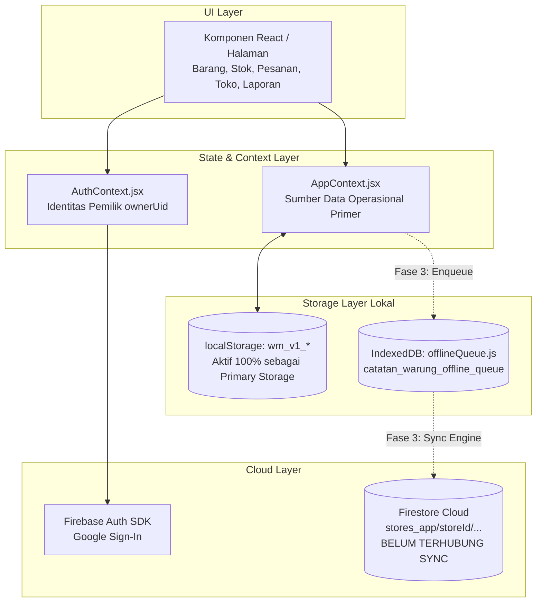
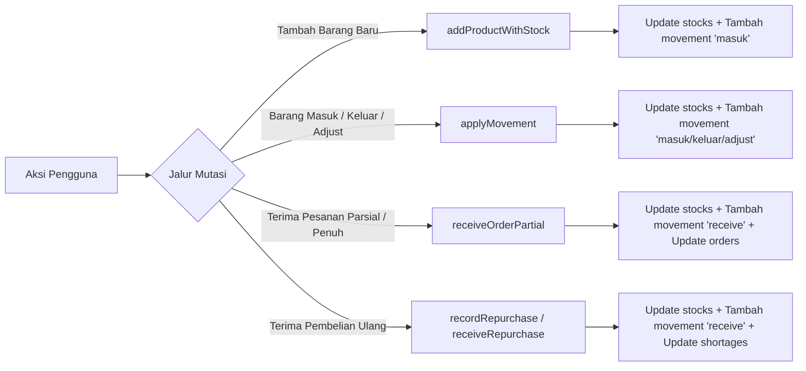
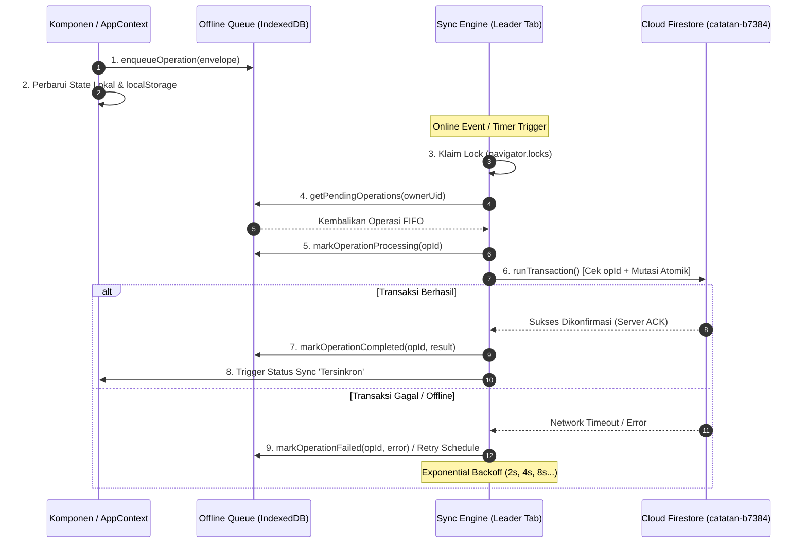

# LAPORAN AUDIT PREFLIGHT FASE 3: KESIAPAN FIRESTORE SYNC ENGINE

**Proyek:** Catatan Warung Madura  
**Firebase Project ID:** `catatan-b7384`  
**Status Audit:** PREFLIGHT AUDIT ONLY — NO CODE CHANGES  
**Tanggal Audit:** 20 November 2026  
**Dasar Analisis:** Source Code Aktual Repositori (`src/*`, `firestore.rules`, `package.json`)

---

## 1. EXECUTIVE SUMMARY

Audit preflight ini dilaksanakan sebelum memulai implementasi **Fase 3: Firestore Sync Engine** pada aplikasi Catatan Warung Madura. Audit berfokus pada evaluasi codebase aktual tanpa asumsi, memeriksa integrasi antara penyimpanan operasional lokal (`localStorage`), antrean persisten IndexedDB (`src/services/offlineQueue.js`), Firebase Authentication (`src/services/firebase.js`), serta Firestore Security Rules (`firestore.rules`).

### Temuan Kunci Audit:
1. **Karakter Asli Aplikasi [VERIFIED]:**
   Aplikasi Catatan Warung Madura adalah **sistem internal manajemen stok inventaris, pemesanan ke toko pemasok, dan penerimaan barang fisik** (ditegaskan di `src/pages/Pengaturan.jsx:1350`). Aplikasi ini **bukan aplikasi kasir POS ritel** dan tidak memiliki modul penjualan langsung ke pembeli ataupun pencatatan utang pelanggan. Istilah "toko" (`stores`) dalam kode merujuk pada **Toko Pemasok/Grosir (Suppliers)**, bukan cabang warung ritel.
2. **Kesiapan Offline Queue [VERIFIED]:**
   Modul `offlineQueue.js` telah memiliki skema IndexedDB yang kokoh, isolasi `ownerUid` mandatori, generator `opId` unik berbasis *timestamp + random*, dan immutabilitas `opId` saat *retry*. Namun, ditemukan celah konkurensi antar-tab (*multi-tab race condition*) dan ketiadaan pengecekan status `completed` pada fungsi `retryOperation`.
3. **Integritas Mutasi Stok [VERIFIED]:**
   Seluruh mutasi kuantitas stok di `AppContext.jsx` terikat pada pencatatan `movements`. Di Firestore Rules, proteksi `isValidStockUpdate` mewajibkan pembaruan stok harus menyertakan dokumen `movements/{opId}` secara atomik (`existsAfter`).
4. **Kebutuhan Domain Pilot [VERIFIED]:**
   Domain **Toko Pemasok (`stores`)** direkomendasikan sebagai domain pilot pertama karena memiliki risiko bisnis terendah, beroperasi sebagai entitas independen tanpa mutasi stok/keuangan, dan memiliki siklus CUD lengkap.
5. **Kesiapan Menuju Fase 3:**
   Arsitektur dasar siap melangkah ke Fase 3 dengan syarat menyelesaikan 4 blocker desain (resolusi `storeId`, proteksi *multi-tab lock*, proteksi `retryOperation`, dan penegasan strategi soft-delete stok).

---

## 2. KONDISI ARSITEKTUR AKTUAL CODEBASE



### Komponen Eksisting:
- **Runtime:** React 18 + Vite (1.987 modul terkompilasi bersih).
- **Penyimpanan Operasional Primer [VERIFIED]:** `localStorage` dengan prefiks `wm_v1_*`. Seluruh pembacaan awal dan penulisan mutasi saat ini bermuara ke `localStorage`.
- **Fondasi Antrean Offline [VERIFIED]:** Modul `src/services/offlineQueue.js` berbasis IndexedDB versi 1 (`catatan_warung_offline_queue`, store `operations`). Lulus 14/14 uji skenario.
- **Autentikasi & Identitas [VERIFIED]:** Google Sign-In via `src/services/firebase.js` dan `src/context/AuthContext.jsx`. Menghasilkan `ownerUid` kriptografis murni.
- **Security Rules [VERIFIED]:** `firestore.rules` versi 3 dengan 33/33 uji emulator lulus. Mengatur struktur tenant `/stores_app/{storeId}/...`.
- **Cloud Sync:** Saat ini **belum ada koneksi sinkronisasi otomatis**. Firestore hanya digunakan untuk backup manual satu dokumen `warung_madura/latest_backup`.

---

## 3. INVENTARIS SELURUH DOMAIN AKTUAL APLIKASI

Berdasarkan pemeriksaan mendalam terhadap kode sumber repositori, berikut adalah inventarisasi data aktual:

| Domain | Sumber / Kunci Penyimpanan | ID Unik | Relasi Entitas | Fungsi CUD di Kode | Risiko Konflik | Tingkat Keamanan Sync | Status Verifikasi |
| :--- | :--- | :--- | :--- | :--- | :--- | :--- | :--- |
| **Suppliers (Toko Pemasok)** | `localStorage: wm_v1_stores` | `st-...` | Dirujuk oleh `products.storeIds`, `orders.storeId` | `createStore`, `updateStore`, `deleteStore` | Rendah | **Sangat Aman (Rekomendasi Pilot)** | `[VERIFIED]` |
| **Products (Master Barang)** | `localStorage: wm_v1_products` | `p-...` | `storeIds` -> `stores.id`, `units[].id` | `saveProduct`, `addProductWithStock`, `updateProduct`, `archiveProduct`, `deleteProduct` | Sedang | Aman (setelah Toko Pemasok) | `[VERIFIED]` |
| **Stocks (Stok Inventaris)** | `localStorage: wm_v1_stocks` | `k-...` (1:1 per barang) | `productId` -> `products.id` | `upsertStock`, `updateStockPrices`, `applyMovement`, `deleteStock` | **Kritis / Tinggi** | Memerlukan Transaksi Atomik dengan Movement | `[VERIFIED]` |
| **Movements (Mutasi Stok)** | `localStorage: wm_v1_movements` | `mv-...` | `productId`, `ref` -> `orderId` / `shortageId` | `applyMovement`, `addProductWithStock`, `receiveOrderPartial`, `receiveRepurchase` | **Kritis / Tinggi** | Wajib Atomik (Append-Only) | `[VERIFIED]` |
| **Store Prices (Harga Pemasok)** | `localStorage: wm_v1_storePrices` | `sp-...` | `storeId`, `productId`, `unitId` | `saveStorePrices`, `resetStorePrice` | Sedang | Aman (setelah Produk & Pemasok) | `[VERIFIED]` |
| **Store Carts (Draft Pesanan)** | `localStorage: wm_v1_store_carts` | `storeId` | `storeId` -> `stores.id` | `getStoredCarts`, `persistStoredCarts` (di `Toko.jsx`) | Rendah | Opsional (Draft Perangkat Lokal) | `[VERIFIED]` |
| **Orders (Pesanan Kulakan)** | `localStorage: wm_v1_orders` | `P-YYYYMMDD-XXX` | `storeId`, `items[].productId` | `createOrder`, `receiveOrderPartial`, `completeOrderWithShortages`, `cancelOrder` | **Tinggi** | Perlu Rekonsiliasi Penerimaan | `[VERIFIED]` |
| **Shortages (Kekurangan Barang)**| `localStorage: wm_v1_shortages` | `sk-...` | `orderId`, `productId`, `storeId` | `completeOrderWithShortages`, `recordRepurchase`, `receiveRepurchase`, `markShortageSold` | Sedang-Tinggi | Aman (setelah Pesanan) | `[VERIFIED]` |
| **Price History (Riwayat Harga)** | `localStorage: wm_v1_priceHistory` | `ph-...` | `storeId`, `productId`, `unitId` | Otomatis dibuat saat `saveStorePrices` | Nol (Append-Only) | Sangat Aman (Append-Only) | `[VERIFIED]` |
| **Activity Logs (Log Audit)** | `localStorage: wm_v1_activityLogs` | `act-...` | Snapshot operator & aksi | `addActivityLog` | Nol (Append-Only) | Sangat Aman (Append-Only) | `[VERIFIED]` |
| **Operators (Petugas Warung)** | `localStorage: wm_v1_operators` | `op-...` | Disematkan ke log & mutasi | `addOperator`, `updateOperator`, `toggleOperatorStatus` | Rendah | Sangat Aman | `[VERIFIED]` |
| **Settings (Profil Warung)** | `localStorage: wm_v1_settings` | Dokumen tunggal | Pengaturan tema & notifikasi | `updateSettings` | Rendah | Sangat Aman | `[VERIFIED]` |
| **Notifications (Status Baca)** | `localStorage: wm_v1_readNotifIds` | Array string ID | Dihitung dari stok/pesanan | `markAllNotifsRead`, `markNotifRead` | Rendah | Sangat Aman | `[VERIFIED]` |
| **Supplier Catalog** | *Belum ada di storage lokal* | `cat-...` | Hanya ada di `firestore.rules` | Belum ada implementasi UI | - | Menunggu Rilis Modul | `[NOT VERIFIED]` |
| **Visit Schedules & Logs** | *Belum ada di storage lokal* | `sch-...` / `log-...`| Hanya ada di `firestore.rules` | Belum ada implementasi UI | - | Menunggu Rilis Modul | `[NOT VERIFIED]` |
| **Digital Notes (PPOB/Transfer)** | *Belum ada di storage lokal* | `TRX-...` | Hanya ada di `firestore.rules` | Belum ada implementasi UI | - | Menunggu Rilis Modul | `[NOT VERIFIED]` |
| **Transactions & Debts (POS/Utang)** | *Tidak ada di aplikasi* | - | Tidak ada modul kasir POS / hutang | Tidak ada | - | Diluar Cakupan Aplikasi Warung | `[NOT VERIFIED]` |

---

## 4. AUDIT MENDALAM OFFLINE QUEUE (`src/services/offlineQueue.js`)

Pemeriksaan baris demi baris pada berkas `src/services/offlineQueue.js` menghasilkan evaluasi berikut:

1. **Apakah seluruh operasi mempunyai `ownerUid`?**
   - **Status:** `[VERIFIED]`
   - **Bukti:** Pada baris 115-117:
     ```javascript
     if (!ownerUid || typeof ownerUid !== 'string') {
       return { ok: false, error: 'Atribut ownerUid wajib diisi untuk isolasi kepemilikan data.' };
     }
     ```
     Fungsi menolak operasi jika `ownerUid` tidak valid atau kosong.
2. **Apakah `opId` benar-benar immutable selama retry?**
   - **Status:** `[VERIFIED]`
   - **Bukti:** Pada fungsi `retryOperation(opId)` (baris 378-393), objek antrean diambil melalui `store.get(opId)` dan disimpan kembali dengan status `pending` serta `retryCount++`. Nilai `opId` asli dipertahankan secara utuh tanpa regenerasi string ID.
3. **Apakah operasi `processing` bisa diklaim oleh dua tab sekaligus?**
   - **Status:** `[POTENTIAL RISK]`
   - **Bukti:** Fungsi `getPendingOperations(ownerUid)` (baris 202-229) dan `markOperationProcessing(opId)` (baris 234-270) tidak memiliki mekanisme *distributed locking* antar-jendela browser. Jika pengguna membuka 2 tab sekaligus, Tab 1 dan Tab 2 dapat membaca item pending yang sama secara bersamaan, sehingga terjadi klaim ganda (*race condition*).
   - **Solusi Rekomendasi:** Implementasikan Web Locks API (`navigator.locks.request('catatan_warung_sync_leader', ...)`).
4. **Apakah stale processing recovery aman terhadap operasi yang sebenarnya masih berjalan?**
   - **Status:** `[POTENTIAL RISK]`
   - **Bukti:** Pada baris 431-438, `recoverStaleProcessingOperations` memulihkan status operasi dari `processing` menjadi `pending` jika waktu proses melebihi 60 detik (`now - startedAt > staleTimeoutMs`). Jika koneksi internet sangat lambat dan request Firestore membutuhkan waktu 65 detik, operasi dapat dipulihkan ke `pending` dan diambil oleh tab lain, sementara request pertama sebenarnya berhasil. Idempotensi Firestore Rules akan memblokir duplikasi mutasi stok, namun status di lokal dapat mengalami desinkronisasi sementara.
5. **Apakah status `completed` benar-benar terkunci?**
   - **Status:** `[VERIFIED VULNERABILITY / POTENTIAL RISK]`
   - **Bukti:** Pada `enqueueOperation` (baris 137-146), operasi duplikat berstatus `completed` ditolak dengan aman. Namun pada fungsi `retryOperation(opId)` (baris 378-393), **tidak ada validasi pengecekan status saat ini**:
     ```javascript
     // offlineQueue.js baris 378:
     getReq.onsuccess = () => {
       const op = getReq.result;
       if (!op) { ... }
       // TIDAK ADA pengecekan: if (op.status === QUEUE_STATUS.COMPLETED) return error!
       op.status = QUEUE_STATUS.PENDING;
     ```
     Jika `retryOperation` secara tidak sengaja dipanggil untuk operasi yang sudah selesai, statusnya akan berbalik menjadi `pending`.
   - **Dampak:** Kerentanan ini harus dicegah dengan menambahkan *guard* status sebelum Fase 3 aktif.
6. **Apakah `failed` bisa dipulihkan tanpa membuat operasi baru?**
   - **Status:** `[VERIFIED]`
   - **Bukti:** Fungsi `retryOperation(opId)` membaca entri lama, mereset `lastError = null`, menaikkan `retryCount`, dan mengembalikan status ke `pending` tanpa membuat entri baru di IndexedDB.
7. **Apakah operasi milik UID lain benar-benar tidak dapat diproses?**
   - **Status:** `[VERIFIED]` untuk antrean pending; `[POTENTIAL RISK]` untuk pemanggilan langsung.
   - **Bukti:** `getPendingOperations(ownerUid)` dan `recoverStaleProcessingOperations(ownerUid)` menggunakan indeks komposit `by_owner_status` dengan parameter `IDBKeyRange.only([ownerUid, status])`. Namun fungsi `markOperationProcessing(opId)` dan `markOperationCompleted(opId)` hanya menerima `opId` tanpa parameter validasi `expectedOwnerUid`.
8. **Apakah payload dapat divalidasi sebelum dikirim?**
   - **Status:** `[VERIFIED]`
   - **Bukti:** `offlineQueue.js` hanya memvalidasi bahwa payload bertipe objek (`typeof payload === 'object'`). Validasi skema bisnis per-entitas (misalnya: kuantitas stok harus angka > 0) harus dijalankan oleh Sync Engine sebelum memproses pengiriman.
9. **Apakah diperlukan `schemaVersion`?**
   - **Status:** `[VERIFIED]`
   - **Bukti:** Dokumen amplop antrean telah menyertakan `schemaVersion: DB_VERSION` (baris 160).
10. **Apakah operasi antrean memiliki identitas entitas yang cukup untuk deduplikasi?**
    - **Status:** `[VERIFIED]`
    - **Bukti:** Amplop memiliki field `entityType`, `entityId`, `operationType`, serta indeks komposit `store.createIndex('by_entity', ['entityType', 'entityId'])`.

---

## 5. AUDIT FIREBASE AUTHENTICATION & IDENTITAS PEMILIK

Audit terhadap [src/services/firebase.js](file:///d:/catatan/src/services/firebase.js) dan [src/context/AuthContext.jsx](file:///d:/catatan/src/context/AuthContext.jsx):

1. **Keaslian Identitas `ownerUid` [VERIFIED]:**
   `ownerUid` berasal dari `auth.currentUser.uid` Google Sign-In yang diterbitkan resmi oleh Firebase Authentication. Nilai ini tidak dimanipulasi, tidak menggunakan fallback lokal, dan tidak bercampur dengan nama kasir warung.
2. **Kondisi Offline & Sesi Lokal [VERIFIED]:**
   Inisialisasi autentikasi telah mengonfigurasi `browserLocalPersistence`. Saat perangkat offline atau browser dimuat ulang tanpa koneksi, token sesi pengguna tetap tersimpan di penyimpanan lokal browser, sehingga `currentUser` dan `ownerUid` tetap tersedia bagi antrean offline.
3. **Pemisahan Pemilik vs Operator Warung [VERIFIED]:**
   Operator manual warung (Ainie, Ibu, AA, Adik) dikelola secara lokal di `wm_v1_operators` dan disematkan sebagai snapshot audit `{ operatorId, operatorName }`. Operator tidak memiliki akun login Firebase dan tidak memengaruhi kepemilikan data di cloud.

---

## 6. AUDIT FIRESTORE SECURITY RULES AKTUAL

Audit terhadap berkas [firestore.rules](file:///d:/catatan/firestore.rules):

1. **Isolasi Root Multi-Tenant [VERIFIED]:**
   Aturan `isStoreOwner(storeId)` (baris 16-20) mewajibkan:
   ```javascript
   request.auth.uid == get(/databases/$(database)/documents/stores_app/$(storeId)).data.ownerUid
   ```
   Pengguna dengan UID A tidak dapat membaca atau menulis ke `/stores_app/{storeB}/...`.
2. **Koleksi & Subkoleksi yang Dilindungi [VERIFIED]:**
   Rules telah mendefinisikan izin spesifik untuk:
   `meta/*`, `operators`, `products`, `stocks`, `suppliers`, `store_prices`, `supplier_catalog`, `draft_carts`, `visit_schedules`, `visit_logs`, `orders`, `shortages`, `digital_notes`, `movements`, `activity_logs`, `price_history`, dan `restore_staging`.
3. **Immutabilitas Riwayat [VERIFIED]:**
   Subkoleksi `movements/{opId}`, `activity_logs/{logId}`, dan `price_history/{historyId}` memiliki proteksi `allow update, delete: if false;`.
4. **Proteksi Mutasi Stok Atomik (`isValidStockUpdate`) [VERIFIED]:**
   Pada baris 41-55:
   Jika terjadi perubahan `quantity` pada dokumen `/stocks/{productId}`, Rules **mewajibkan**:
   - `lastReconciledOpId` wajib terisi string valid.
   - Dokumen `/movements/{lastReconciledOpId}` **wajib ada dalam transaksi yang sama** (`existsAfter`).
   - `diffBase` pada dokumen mutasi harus sama persis dengan selisih `quantity` stok baru dikurangi stok lama.
5. **Celah / Ketiadaan Ledger Operasi Umum [VERIFIED FINDING]:**
   Rules Fase 0 mengamankan idempotensi mutasi stok melalui `/movements/{opId}`. Namun untuk entitas non-stok (seperti pembaruan `suppliers` atau `orders`), tidak ada subkoleksi `/operations_log/{opId}` di dalam `firestore.rules`. Idempotensi entitas non-stok harus mengandalkan penulisan dokumen berbasis ID entitas (`setDoc` dengan ID deterministik) atau menambahkan aturan `operations_log` jika audit transaksi menyeluruh diperlukan.

---

## 7. AUDIT JALUR MUTASI STOK DAN TRANSAKSI

Penelusuran seluruh alur kode yang memodifikasi stok pada [src/context/AppContext.jsx](file:///d:/catatan/src/context/AppContext.jsx):



### Evaluasi Integritas Stok:
1. **Apakah stok bisa berubah tanpa movement? [VERIFIED - TIDAK]**
   Di seluruh alur operasional (`addProductWithStock`, `applyMovement`, `receiveOrderPartial`, `recordRepurchase`, `receiveRepurchase`), pembaruan `stocks` selalu disertai penambahan entri ke `movements`.
2. **Operasi yang Wajib Atomik di Firestore Sync:**
   - **Penerimaan Pesanan:** Pembaruan status pesanan di `orders/{orderId}` + pembaruan `stocks/{productId}` + pembuatan `movements/{opId}`. Jika salah satu gagal, seluruh pembaruan harus dibatalkan (*rollback*).
   - **Penyesuaian Fisik Stok:** Pembaruan `stocks/{productId}` + pembuatan `movements/{opId}`.
3. **Ketidaksesuaian Fungsi `deleteStock` dengan Rules [VERIFIED CONFLICT]:**
   - Di `src/context/AppContext.jsx:952`, terdapat fungsi `deleteStock(id)`.
   - Di `src/pages/Stok.jsx:786`, modal konfirmasi menghapus catatan stok fisik.
   - Namun di `firestore.rules:170`: `match /stocks/{productId} { allow delete: if false; }`.
   - **Dampak:** Jika Sync Engine mencoba mengirim operasi penghapusan dokumen stok ke Firestore, request akan ditolak oleh Rules (`PERMISSION_DENIED`). Stok harus dikelola melalui *soft-delete* / penonaktifan produk, bukan menghapus fisik dokumen stok.

---

## 8. ANALISIS RISIKO CONCURRENCY & RACE CONDITION

1. **Multi-Tab Execution [POTENTIAL RISK]:**
   Pengguna membuka aplikasi di dua tab browser (misal Tab A membuka halaman Stok, Tab B membuka halaman Pesanan).
   - *Risiko:* Kedua tab mendeteksi online dan secara simultan mengambil antrean dari IndexedDB, memproses item yang sama, dan mengirim dua transaksi ke Firebase.
   - *Mitigasi:* Gunakan Web Locks API (`navigator.locks`) untuk memilih satu tab sebagai *Sync Worker Leader*. Tab non-leader hanya mengantrekan operasi tanpa mengeksekusi sinkronisasi.
2. **Persaingan Mutasi Stok Antar-Perangkat [POTENTIAL RISK]:**
   Perangkat 1 mengurangi stok produk P sebesar 5 (stok lokal 20 -> 15). Pada saat bersamaan saat offline, Perangkat 2 mengurangi produk P sebesar 10 (stok lokal 20 -> 10).
   - *Risiko:* Jika menggunakan metode set-dokumen sederhana (*blind write*), perangkat terakhir akan menimpa stok perangkat pertama (menjadi 10, bukan 5).
   - *Mitigasi:* Rekonsiliasi mutasi stok di Firestore **harus menggunakan `runTransaction()`** yang menerapkan delta matematis (`quantity = currentQuantity + diffBase`), bukan menimpa nilai absolut.

---

## 9. ANALISIS RISIKO DUPLIKASI DATA

1. **Jaringan Terputus Saat Request In-Flight [POTENTIAL RISK]:**
   Klien mengirim paket transaksi pesanan ke Firestore. Server Firestore berhasil mencatat transaksi, tetapi jaringan terputus sebelum acknowledge (ACK) diterima klien.
   - *Kondisi:* Klien menganggap operasi gagal dan menjadwalkan *retry* dengan `opId` yang sama.
   - *Evaluasi Keamanan:* Karena `opId` bersifat kekal (*immutable*), saat *retry* dieksekusi, dokumen `movements/{opId}` sudah ada di server. Transaksi server mendeteksi keberadaan `opId` tersebut dan menghentikan mutasi ulang stok (*idempotent no-op*).
2. **Penamaan ID Entitas Deterministik [VERIFIED]:**
   Seluruh ID entitas lokal menggunakan format berbasis prefix deterministik (`st-...`, `p-...`, `P-YYYYMMDD-XXX`, `sk-...`). Klien mengirim `setDoc(doc(db, col, entityId))` alih-alih `addDoc()`. Hal ini menjamin bahwa pengiriman ulang operasi pembuatan entitas tidak akan menghasilkan dua dokumen berbeda di Firestore.

---

## 10. ANALISIS RISIKO KONFLIK DATA (LOCAL VS CLOUD)

1. **Penimpaan Data Lokal Saat Tarik Data Cloud [POTENTIAL RISK]:**
   Jika Sync Engine mengunduh snapshot dari Cloud dan langsung menimpanya ke `localStorage` sementara masih ada operasi lokal yang berstatus `pending` di IndexedDB, perubahan lokal pengguna yang belum tersinkronisasi akan terhapus (*data loss*).
   - *Mitigasi Mutlak:* Sync Engine **harus menguras (*drain*) seluruh operasi pending di antrean lokal terlebih dahulu** sebelum menerapkan pembaruan downstream dari Firestore ke `localStorage`.
2. **Konflik Pembaruan Data Bersamaan (Last-Write-Wins) [POTENTIAL RISK]:**
   Dua operator mengedit nama barang yang sama secara offline dengan teks berbeda.
   - *Mitigasi:* Gunakan resolusi konflik berbasis *clientTimestamp* ISO (`updatedAt`). Versi dengan timestamp paling mutakhir yang dipertahankan (*LWW with timestamp guard*).

---

## 11. REKOMENDASI ARSITEKTUR SYNC ENGINE (FASE 3)



### Spesifikasi Desain Mesin:
1. **Sync Worker Singleton via Web Locks:**
   Menggunakan `navigator.locks.request('catatan_warung_sync_engine', ...)` untuk memastikan hanya satu tab yang menjadi worker aktif pemroses antrean.
2. **Alur Siklus Operasi:**
   `Enqueue` $\rightarrow$ `Claim Lock` $\rightarrow$ `Validate Payload` $\rightarrow$ `Execute Firestore Transaction` $\rightarrow$ `Acknowledge & Mark Completed`.
3. **Idempotensi Dua Tingkat:**
   - **Tingkat 1 (Lokal):** IndexedDB memeriksa `store.get(opId)` untuk menduplikasi input.
   - **Tingkat 2 (Server):** Firestore Transaction memeriksa keberadaan dokumen `/movements/{opId}` atau record log operasi sebelum mengubah data.
4. **Strategi Retry & Backoff:**
   Maksimal 5 kali percobaan ulang otomatis untuk kesalahan transien (*network timeout*), dengan jeda bertingkat (*exponential backoff with jitter*: 2s, 4s, 8s, 16s, 32s). Operasi gagal permanen (*permission denied* atau *validation error*) ditandai `failed` untuk ditinjau di kartu diagnostik Pengaturan.

---

## 12. URUTAN IMPLEMENTASI BERTAHAP (DOMAIN SEQUENCING)

Untuk meminimalkan risiko regresi pada data operasional warung, implementasi integrasi domain pada Fase 3 wajib dilakukan secara bertahap:

```text
[FASE 3A] Fondasi Sync Engine + Pilot Domain (Suppliers / Toko Pemasok)
   │
   ▼
[FASE 3B] Sinkronisasi Metadata Ringan (Settings, Operators, Read Notifications)
   │
   ▼
[FASE 3C] Sinkronisasi Master Produk & Harga (Products, Store Prices, Price History)
   │
   ▼
[FASE 3D] Sinkronisasi Log Audit (Activity Logs) & Keranjang Draft (Store Carts)
   │
   ▼
[FASE 3E] Sinkronisasi Domain Kritis (Orders, Shortages, Stocks + Movements Atomik)
   │
   ▼
[FASE 3F] Verifikasi Penuh Multi-Perangkat, Uji Rekonsiliasi, & Stress Testing
```

---

## 13. DOMAIN PILOT YANG DIREKOMENDASIKAN: TOKO PEMASOK (`stores`)

Domain **Toko Pemasok (`wm_v1_stores`)** terpilih secara mutlak sebagai **Domain Pilot Pertama (Fase 3A)** berdasarkan pertimbangan:
1. **Risiko Bisnis Nol:** Penambahan atau perubahan nama toko pemasok tidak mengubah nominal uang, tidak mengubah kuantitas persediaan stok, dan tidak memicu pergerakan fisik barang.
2. **Entitas Akar Independen:** Tidak bergantung pada master produk atau data pesanan (produk dan pesanan yang bergantung pada pemasok).
3. **Siklus CUD Lengkap:** Memiliki alur `createStore`, `updateStore`, dan `deleteStore` yang ideal untuk menguji seluruh amplop antrean (`CREATE`, `UPDATE`, `DELETE`).
4. **Verifikasi Transparan:** Mudah diverifikasi secara berdampingan antara `localStorage: wm_v1_stores`, `IndexedDB: operations`, dan koleksi `/stores_app/{storeId}/suppliers/{supplierId}` di Firestore.
5. **Uji Kasus Kegagalan Aman:** Sangat aman digunakan untuk menguji simulasi mode offline, pemutusan jaringan mendadak, *retry backoff*, dan pemulihan *stale processing*.

---

## 14. ACCEPTANCE CRITERIA FASE 3

Sebelum Fase 3 dapat dinyatakan selesai dan disetujui, sistem harus memenuhi kriteria keberhasilan berikut:

- [ ] **AC-1:** Operasi CUD pada domain yang aktif otomatis masuk ke Offline Queue IndexedDB dan memperbarui UI secara optimis tanpa lag.
- [ ] **AC-2:** Ketika perangkat online, Sync Engine otomatis mengeksekusi operasi pending secara berurutan (FIFO).
- [ ] **AC-3:** Pengujian konkurensi 2 tab secara simultan tidak menghasilkan eksekusi ganda ke Firestore (*Web Locks verified*).
- [ ] **AC-4:** Pengiriman ulang operasi yang sama (*retry*) tidak menggandakan dokumen di Firestore (*server idempotency verified*).
- [ ] **AC-5:** Mutasi stok di Firestore wajib disertai dokumen movement dalam satu transaksi atomik. Jika salah satu gagal, Firestore Rules menolak penulisan.
- [ ] **AC-6:** Tidak terjadi kehilangan data lokal (`localStorage`) jika browser ditutup paksa saat sinkronisasi sedang berjalan.
- [ ] **AC-7:** Pemulihan otomatis (*stale recovery*) mengembalikan operasi yang menggantung ke status pending setelah timeout.
- [ ] **AC-8:** Seluruh test suite regresi (Fase 0: 33 uji rules, Fase 1: 14 uji auth, Fase 2: 14 uji queue) tetap 100% PASS.
- [ ] **AC-9:** Build produksi Vite sukses tanpa error dan tanpa peningkatan ukuran bundle yang tidak wajar.

---

## 15. DAFTAR BLOCKER SEBELUM IMPLEMENTASI FASE 3

Berikut adalah 4 hal yang wajib disepakati dan dipersiapkan sebelum menulis kode Sync Engine:

1. **Resolusi Tenant ID `storeId` di Firestore:**
   - *Masalah:* Path dokumen Firestore adalah `/stores_app/{storeId}/...`. Saat ini belum ada standarisasi bagaimana string `storeId` dibentuk dari akun Google login.
   - *Rekomendasi:* Tetapkan formula deterministik: `storeId = 'store_' + currentUser.uid` (atau langsung menggunakan `currentUser.uid`), sehingga setiap akun Google memiliki tepat 1 dokumen warung di root `stores_app`.
2. **Penambahan Guard Status pada `retryOperation` di `offlineQueue.js`:**
   - *Masalah:* Fungsi `retryOperation` saat ini dapat dipanggil pada operasi yang sudah `completed`.
   - *Rekomendasi:* Tambahkan pengecekan: jika `status === QUEUE_STATUS.COMPLETED`, kembalikan `{ ok: false, error: 'Operasi yang telah selesai tidak boleh diulang.' }`.
3. **Penyelarasan Logika `deleteStock` vs Firestore Rules:**
   - *Masalah:* UI memiliki tombol hapus catatan stok fisik, namun `firestore.rules` melarang mutlak penghapusan dokumen stok (`allow delete: if false`).
   - *Rekomendasi:* Sepakati bahwa di tingkat cloud, penghapusan stok fisik diubah menjadi kuantitas 0 atau diabaikan, demi menjaga integritas riwayat mutasi stok.
4. **Penyusunan Kontrak Payload Domain Pilot:**
   - *Masalah:* `offlineQueue.js` saat ini menerima sembarang objek payload.
   - *Rekomendasi:* Buat skema validator payload ketat untuk domain pilot `suppliers` (`id`, `name`, `phone`, `address`, `updatedAt`) sebelum dikirim ke Firebase SDK.

---

## 16. KESIMPULAN KESIAPAN & REKOMENDASI GATE 3

Audit preflight menunjukkan bahwa **fondasi kode Catatan Warung Madura berada dalam kondisi sangat sehat, modular, dan siap untuk memulai Fase 3**. 

Pemisahan tanggung jawab antara `localStorage` (kecepatan respon kasir/staf), IndexedDB (ketahanan antrean offline), dan Firebase Auth (isolasi identitas pemilik) telah terbukti solid melalui pengujian Fase 1 dan Fase 2.

**Rekomendasi:**
1. Pengguna/Pemilik menyetujui hasil audit preflight ini.
2. Membuka implementasi **Fase 3A: Fondasi Sync Engine & Pilot Domain Toko Pemasok (`stores`)**.
3. Menyelesaikan 4 blocker teknis di atas pada tahap persiapan Fase 3A.

---

*Laporan Preflight selesai disusun. Tidak ada modifikasi kode aplikasi atau perubahan data produksi selama audit ini.*  
**STATUS: STOPPED — MENUNGGU PERSETUJUAN GATE MENUJU FASE 3A.**
